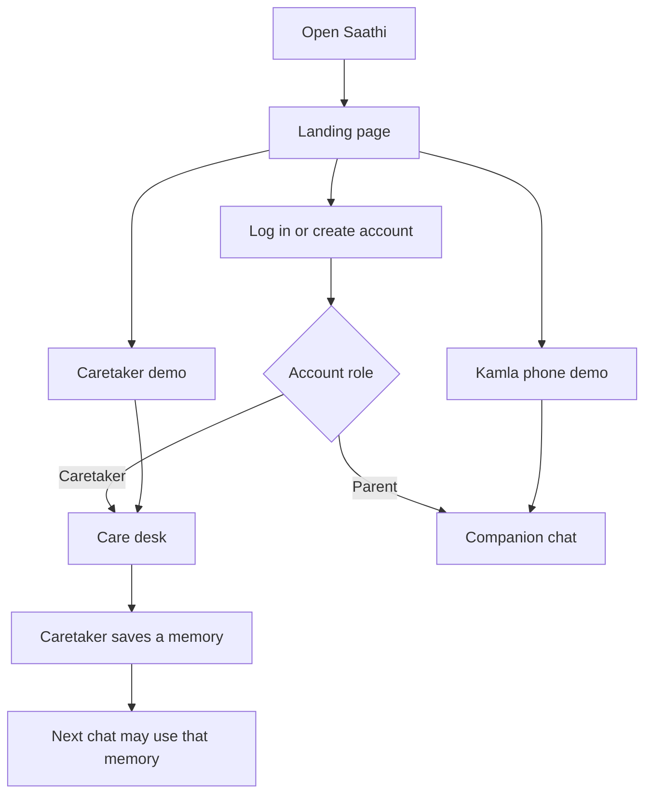
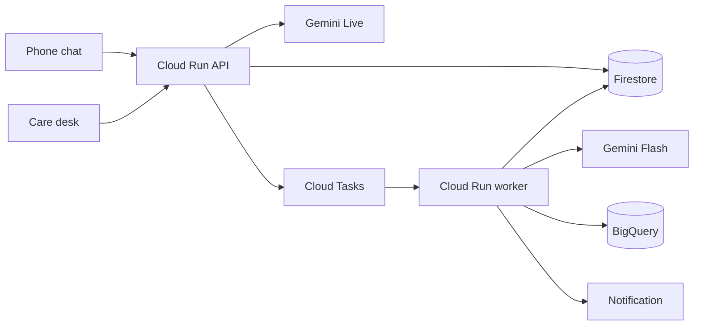

# Saathi

A Hindi companion for an older adult living apart from family. The family keeps the facts on a wide screen. The parent talks on a phone. Google Cloud does the listening, the memory, and the comparison across days.

The expensive minute is an open voice session. Gemini Live runs only inside a four-minute call. Gemini Flash does the work after the call. Cloud Run bills CPU while a request is active and scales to zero. Family memory uses Firestore vector search, so there is no warm vector index. The limits are in `api/src/saathi/cost.py`.

This repository is the AI Builder Cup 2026 prototype. Live voice, Firestore, BigQuery drift, SafetyGuard, and the insight run against a real Google Cloud project. What is checked and what is not is in [docs/PROGRESS.md](docs/PROGRESS.md).

## What you open



| Screen | Who | What they do |
| --- | --- | --- |
| Landing page, `/` | A new family, or a reviewer | Log in, create an account, or open either demo without an account |
| Care desk, `/care` | The caretaker, on a phone or a computer | Store the person's name, people, memories, check-in time, and reminders; read Routine; make a family code |
| Companion chat, `/app` | The older adult | Talk, stop, pause, or contact the family |

## How it runs



The closed phone does not listen. At the saved time the worker sends "Saathi wants to talk." Speech starts after the app opens.

Read the pictures and the rules in the docs:

| Doc | Question it answers |
| --- | --- |
| [docs/SPEC.md](docs/SPEC.md) | What are we building? |
| [docs/ARCHITECTURE.md](docs/ARCHITECTURE.md) | How are we building it? |
| [docs/MASTER_PLAN.md](docs/MASTER_PLAN.md) | What is locked, what is Sunday, what is later? |
| [docs/IMPLEMENTATION_PLAN.md](docs/IMPLEMENTATION_PLAN.md) | Which milestone happens on which day? |
| [docs/PROGRESS.md](docs/PROGRESS.md) | What is done right now? |

## Run it locally

Requires Python 3.12 and Node 22.

```bash
python -m pip install -e "api[dev]"
python -m pytest api/tests
npm install --prefix web
```

Two terminals:

```bash
cd api && python -m uvicorn saathi.main:app --reload --host 127.0.0.1 --port 8080 --app-dir src
npm run dev --prefix web
```

Open `http://localhost:5173`. The landing page links to both demos. A caretaker account opens the care desk at `/care`; a parent account opens the chat at `/app`.

Copy `.env.example` to `.env` when a Google Cloud project id exists. Do not commit `.env`.

## Status

Honesty table (master plan section 14). Kept true at submission time; [docs/PROGRESS.md](docs/PROGRESS.md) has the checks behind each row.

| Item | State |
| --- | --- |
| Public URL | Site https://saathi-5afcf.web.app, API on Cloud Run (`saathi-api`), private worker (`saathi-worker`) |
| Hindi Live conversation on Cloud Run | Built. Model `gemini-live-2.5-flash-native-audio`, voice Aoede. Checked against Vertex from a local API; a turn on the public URL from a second browser is not yet recorded |
| Proactive greeting from an awake tab | Built. Due check-ins need the `saathi-tick` Scheduler job |
| Memory across sessions | Built. A caretaker memory feeds the next greeting |
| Family episodes and Firestore vector search | Built. Embeddings `text-multilingual-embedding-002` |
| In-session distress check | Voice keywords and labeled impact clips (Flash labels the clip). Door clip does not alert |
| Browser speech timing | Built, quality-flagged. Speaking rate is not measured by the live chat |
| Flash extraction | Built. Eval: 30/30 labeled cases on `gemini-2.5-flash` (`make eval`, `eval/report.json`) |
| BigQuery SQL drift | Built. Seeded stable, changing, and fasting histories disagree as expected |
| ARIMA_PLUS | Not built. Not the decision engine |
| ADK tools | Three tools. ADK is an optional install; without it the same tools run in a fixed order |
| SafetyGuard | Built, covered by pytest (`make check SCENARIO=safety`) |
| Voice reminder create and confirm | Built. Saved only after the parent's own yes |
| FCM | Code and service worker in place. A push on a real phone is not yet verified; the in-app banner always works |
| Landing page, care desk, mobile chat | Built. The account role chooses the front: caretaker `/care`, parent `/app` |
| PWA install | Chrome install sheet and iPhone instructions built. A real install on a phone is not yet verified |
| Retention | Worker job: transcripts 7 days, summaries and daily numbers 30 days |
| Background wake word | Not possible in a PWA. A check-in is a notification, then speech in the open app |
| Nest / Google Home | Not built. Milestone M16 |
| Pill identification, gas, glass | Not built. Later work |
| Vertex AI Vector Search endpoint | Not used. Firestore vector search is the index that shipped |
| WhatsApp ingestion | Not built. Family contact comes from what the parent tells Saathi |
| Marathi | Not enabled |
| Clinical validation | Not claimed |

### Not in this prototype

Weekday recurrence edge cases, voice edit of every reminder field, Marathi, Sutra as a full mode, Nest and Google Home (M16), pill recognition, gas and glass detection, a Vertex AI Vector Search endpoint, Agent Engine hosting, Terraform, Maps, SMS, WhatsApp, a composite health score, a background wake word, continuous room listening.

## Deploy

```bash
powershell -File deployment/scripts/setup_cloud.ps1
powershell -File deployment/scripts/deploy.ps1
python scripts/smoke_cloud.py --invoke
```

`setup_cloud.ps1` runs once: the signing secret, the service-account grants, and the two Scheduler jobs. `deploy.ps1` builds one image for both Cloud Run services and deploys Hosting.

Owners: Vibhuti Singh and Srushti Patil. Theme: Sustainability and Social Impact.
