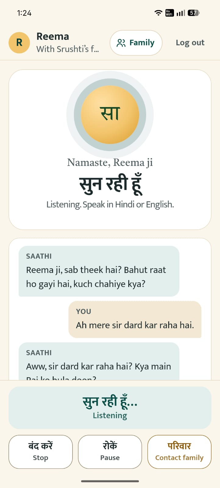
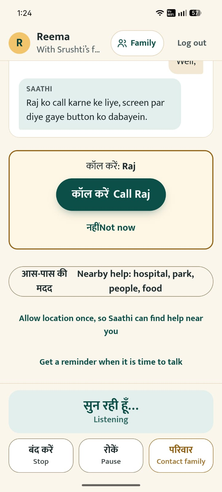
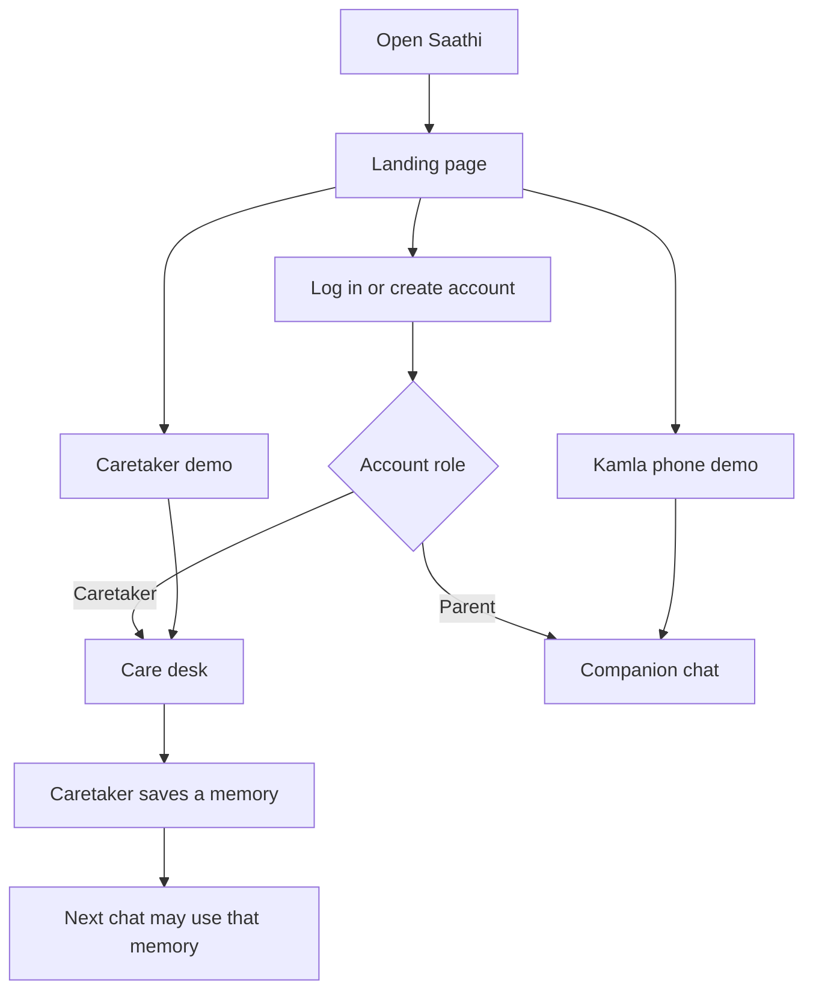
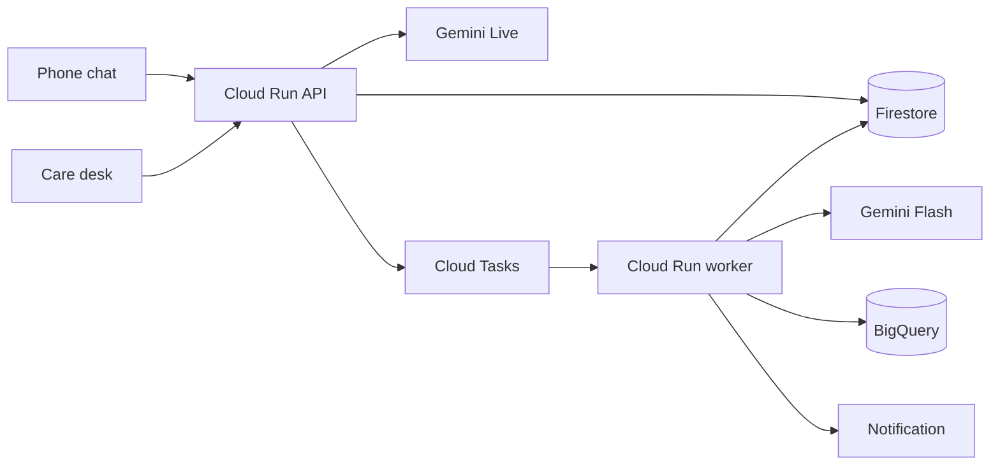

# Saathi

**A voice companion for a parent living alone, spoken in Hindi, and a quiet dashboard for the family far away.**

The parent never types. Saathi sends a gentle notification, then talks with them in Hindi (nine more languages are selectable), remembers their family, and confirms their routine from what they say. The family sees what changed over the weeks, in plain words, without any diagnosis or dose advice.

[Live app](https://saathi-511717.web.app) · [Demo video](https://drive.google.com/file/d/1BYQ_IL3YEwDRZ6upRgihbk1uq7Pawfjr/view?usp=drivesdk) · [Pitch deck](Pitch%20Desk.pdf) · [Try it in 2 minutes](#try-it-in-2-minutes-for-judges) · [Results](#results) · [Architecture](#how-it-runs) · Theme: **Sustainability and Social Impact** · Google Cloud AI Builder Cup 2026

<p align="center">
  
  &nbsp;&nbsp;
  
</p>

<p align="center"><sub>The parent's phone in a test household. Left: listening, in Hindi and English. Right: a Call button the parent taps, and nearby help.</sub></p>

## The problem

More older adults in India live apart from their children. The UNFPA India Ageing Report 2023 counts [149 million people aged 60 or over in 2022 (10.5% of the population), rising to 347 million (20.8%) by 2050](https://www.thenationalnews.com/world/asia/2023/09/28/india-un-elderly-population/). A parent who lives apart from their children often will not type into an app or call to say that something is wrong, so the family hears about a missed meal, a low mood, or a fall afterwards.

Saathi speaks first, so the parent does not have to ask, and gives the family the change, not the surveillance.

## What makes it different

- **The parent only talks.** Gemini Live holds a real-time spoken conversation with natural interruption. No forms, no typing.
- **A closed phone never listens.** A check-in is a notification. Speech starts only after the app is open.
- **A reminder counts only when the parent says so.** "Haan, kar liya" confirms it. A delivered push is only "seen".
- **The family sees drift against the parent's own baseline.** Pause, speaking pace, meals, and family contact are compared with that person's earlier days. A named fast is not a missed meal.
- **SafetyGuard on every sentence the family reads.** A diagnosis, a dose, or an order to enter counselling is replaced by a sentence built from stored facts. Family text is written in English, and the patterns cover English and Roman-script Hindi.
- **Ten languages, two checked by voice.** Hindi, English, and eight other Indian languages are selectable. The phone screens, the lines Saathi says when the model is down, and the help and yes/no words exist in all ten. The team has checked the Live voice in Hindi and in Marathi; the other eight follow the same prompt and have not been checked by voice. [What each language gets](docs/LANGUAGES.md).
- **Help is one tap, from a verified number.** Nearby hospitals, medical shops, parks, and food come from Google Places. The Call button takes its number from stored data, never from the model, and 112, 108, and Elderline 14567 are always there.

## Results

Measured in this repository. Nothing here is a clinical or health-outcome claim.

| What | Result | Where to check |
| --- | --- | --- |
| Automated tests | **111 passed** (API), listed case by case in [docs/TEST_CASES.md](docs/TEST_CASES.md) | `cd api && python -m pytest tests` |
| Memory extraction eval | **30 / 30** labeled cases on `gemini-2.5-flash`, 12 groups | `eval/report.json`, `eval/cases/extraction.jsonl` |
| SafetyGuard tests | **25 / 25** (forbidden diagnoses and doses blocked, safe facts allowed) | `api/tests/test_safety.py` |
| Drift rule tests | **4 / 4** (flags on a real shift, no false flag on stable or fasting data) | `api/tests/test_drift.py` |
| Reply pause (parent stops, Saathi starts) | **about 640 ms** median, measured in the browser during test sessions. A sample, not a benchmark | `web/src/lib/liveAudio.ts` |
| Post-call insight | **about 2.4 s** from session close to the saved card | `api/src/saathi/pipeline.py` |
| Languages | **10 selectable**; Hindi and Marathi checked by voice by the team; Hindi and English covered by automated tests | [docs/LANGUAGES.md](docs/LANGUAGES.md) |
| Deployed check | `smoke_cloud.py`: **8 / 8** on 16 Oct 2026 | [docs/ENVIRONMENT.md](docs/ENVIRONMENT.md) |
| Spend stops | 4-minute call, 120 Live minutes and 500 extraction calls a day, 3 demo calls a visitor a day | `api/src/saathi/cost.py` |

Cloud Run bills CPU while a request is active and scales to zero. Family memory uses Firestore vector search, so there is no warm vector index. This repository is the AI Builder Cup 2026 prototype. What is checked and what is not is in [docs/PROGRESS.md](docs/PROGRESS.md).

## Try it in 2 minutes (for judges)

Open https://saathi-511717.web.app. Neither demo asks for an email.

1. **Kamla's phone** (`/app?demo=1`). Allow the microphone and press Talk. She is a synthetic 78-year-old in Varanasi. Hindi is the Live voice this demo was tested with. Press Stop when you are done. The microphone is off, and a closed tab does not keep listening.
2. **Caretaker demo** (`/care?demo=1`). Open Routine for her own pause and speaking pace, and for the two quotes about her son Rahul. Ask Saathi a question from the examples. Under Photos and documents, **Read the sample page** copies a synthetic note once. Confirm before it is kept.

### What needs a real email

Log in or Create account, with an email and password, or with Google. That is your household, not the shared Kamla desk.

- A care desk and a phone that stay yours after you leave
- A family code that joins the parent's phone to that household
- More than one family member (up to 10)
- Saving a location once, so nearby places use that point instead of the city

Google sign-up asks once who Saathi will talk with, the language, and the city. The account is not created until the agreement about what is kept is ticked: words for 7 days, summaries for 30.

### What the demo does not do

- It is one shared household. A change on the desk is saved, and the next visitor sees it. It is labeled synthetic.
- Three Live sessions a visitor a day. Each talk stops at 4 minutes.
- It does not add family members, does not keep a join, and does not store a location. Nearby help uses Varanasi.
- Contact family on Kamla's phone does not notify a real person.
- The "Phone language" picker on Kamla's phone changes only the words on that phone. The Live voice stays Hindi. Marathi was checked by voice by the team on an account whose profile language is Marathi.
- There is no Nest Home integration yet, and no model machine left running. The sample page is one Gemini Flash read, not a live MedGemma endpoint.

## What you open



| Screen | Who | What they do |
| --- | --- | --- |
| Landing page, `/` | A new family, or a reviewer | Log in, create an account, or open either demo without an account |
| A few details, `/details` | Someone who just signed up with Google | Name, language, and city. Shown once, then the role's home |
| Care desk, `/care` | The caretaker, on a phone or a computer. The screens are in English | Store the person's name, people, memories, check-in time, and reminders; read Routine; make a family code; switch among the family members they look after (up to 10) |
| Companion chat, `/app` | The older adult | Talk, stop, pause, contact the family, or ask for help nearby |

## How it runs



The closed phone does not listen. At the saved time the worker sends "Saathi wants to talk." Speech starts after the app opens.

Read the pictures and the rules in the docs:

| Doc | Question it answers |
| --- | --- |
| [docs/PROJECT_OVERVIEW.md](docs/PROJECT_OVERVIEW.md) | Executive summary, submission guide, and Google Cloud / Firebase integration breakdown |
| [docs/CODEBASE_FACTS_OPTIMIZATIONS_AND_STACK.md](docs/CODEBASE_FACTS_OPTIMIZATIONS_AND_STACK.md) | Deep technical blueprint, Gen AI latency optimizations, and cost-saving architecture |
| [docs/SPEC.md](docs/SPEC.md) | What are we building? |
| [docs/ARCHITECTURE.md](docs/ARCHITECTURE.md) | How are we building it? |
| [docs/MASTER_PLAN.md](docs/MASTER_PLAN.md) | What is in the submitted prototype, and what comes later? |
| [docs/IMPLEMENTATION_PLAN.md](docs/IMPLEMENTATION_PLAN.md) | Which milestone happens on which day? |
| [docs/PROGRESS.md](docs/PROGRESS.md) | What is done right now? |
| [docs/DECISIONS.md](docs/DECISIONS.md) | Why these choices? |
| [docs/LANGUAGES.md](docs/LANGUAGES.md) | Which languages work, in which layer, and what has been checked? |
| [docs/TEST_CASES.md](docs/TEST_CASES.md) | Which tests and evals exist, what each case proves, and how to run them? |
| [docs/PRIVACY.md](docs/PRIVACY.md) | What is stored, and for how long? |
| [docs/ENVIRONMENT.md](docs/ENVIRONMENT.md) | Which project ids and URLs were actually checked? |

## Run it locally

Requires Python 3.12+ (or virtualenv) and Node 22+.

Using Makefile:
```bash
make setup     # Install Python dev dependencies and web node modules
make test      # Run the API unit and integration tests (111 at the last run)
make api       # Start public API on port 8080
make worker    # Start background worker on port 8081
make web       # Start Vite dev server on port 5173
```

Or manually:
```bash
python -m pip install -e "api[dev]"
python -m pytest api/tests
npm install --prefix web
```

Two terminals:

```bash
cd api && python -m uvicorn saathi.main:app --reload --host 127.0.0.1 --port 8080 --app-dir src
npm run dev --prefix web
```

Open `http://localhost:5173`. The landing page links to both demos. A caretaker account opens the care desk at `/care`; a parent account opens the chat at `/app`.

Copy `.env.example` to `.env` when a Google Cloud project id exists. Do not commit `.env`.

## What is finished

The product below is in the running app at https://saathi-511717.web.app. Open it with no account and try the Kamla Sharma phone or the caretaker demo. Both households are synthetic and labeled.

Saathi already knows the household before the parent speaks, and the voice path stays short:

- **Context first.** The Live prompt holds the name, language, city, the people who matter, saved memories and corrections, reminders, recent summaries, declined topics, and one family thread when a named person has gone quiet. It is ready when the greeting starts, so no database read waits in the middle of a sentence.
- **A live stream, not an upload.** The socket to Gemini Live opens as the chat page opens. Talk sends "start" on a connection that is already up. Microphone audio is 16 kHz PCM sent as it is captured. The voice comes back as 24 kHz PCM and plays gapless. If the parent talks over Saathi, the queued audio is dropped.
- **Heavy work stays off the call.** Extraction, embeddings, and the drift comparison run on the worker after the call ends.
- **Six tools act during the call:** `propose_reminder`, `confirm_reminder`, `upcoming_occasions`, `find_nearby`, `offer_call`, and `get_family_context`.

| Capability | What a judge sees |
| --- | --- |
| Public app | https://saathi-511717.web.app, API `saathi-api`, private worker `saathi-worker` |
| Live conversation | Gemini Live `gemini-live-2.5-flash-native-audio`, voice Aoede, at most four minutes. Hindi in the Kamla demo. Hindi and Marathi are the languages the team has checked by voice. Eight more follow the profile through the prompt: English, Bengali, Gujarati, Punjabi, Tamil, Telugu, Kannada, Malayalam |
| Full context on every turn | Name, people, memories, reminders, recent summaries, declined topics, and the family thread are in the system instruction before the first word |
| Fast reply | Socket opened before Talk. PCM in and out with no upload step. Barge-in stops playback. Post-call work stays off this path |
| Memory across sessions | A fact the caretaker saves is in the next greeting. A correction from a conversation is kept beside it |
| Family episodes | Quotes stored with embeddings `text-multilingual-embedding-002` and found by Firestore vector search |
| Distress during the call | Help and negation words in all ten languages (tests cover Hindi and English only), plus a short clip labeled by Flash. A door does not alert. "I did not fall" does not alert |
| Proactive check-in | At the saved time, a push says "Saathi wants to talk". An open chat greets without another tap. Later counts as a response. A blocked microphone is "device unavailable" |
| Push notifications | Firebase Cloud Messaging. The parent and the caretaker each turn them on from the app. The service worker shows the notice, and if the app is already open it speaks the line. A tap opens the chat and then speaks. The lock screen never carries a name, a quote, or a dose |
| Spoken "I have done it" | When a reminder is due and the parent agrees ("haan", "kar lunga", "ja raha hoon", "done"), that reminder is confirmed for today. A delivered push is only "seen". A bare "ji" is not agreement |
| Voice reminders | The parent can create one by talking. Saathi reads it back and saves it only after their own yes. Kinds: medicine, exercise, call, meal, other. Once or daily |
| Ask Saathi | The caretaker types or dictates a change. It is saved only after confirm. A question about how the parent has been is answered from stored facts and checked by SafetyGuard |
| Drift | BigQuery compares this person with their own earlier days. A named fast is not a nutrition alert. Eval of extraction: 30/30 labeled cases on `gemini-2.5-flash` |
| SafetyGuard | Every sentence the family sees is checked against English and Roman-script Hindi patterns. A diagnosis, a dose, or an order to enter counselling is replaced by a sentence built from the stored facts. The second prescription summary in the parent's language goes through the same patterns, which do not cover other scripts, so the caretaker confirms every line |
| Insight | Three tools, in a fixed order, or an optional ADK agent that can only word the notice. The code chooses the tier and the evidence |
| Nearby help | Hospitals, medical shops, grocery stores, parks, and food, plus any other place they name, trusted people, and 112, 108, and Elderline 14567. The parent taps Call. A list from the last day is reused. A festival question reads Google's India holiday calendar through the Calendar API (once a day, with a built-in list as backup) and does not search for a place |
| Several family members | One caretaker, up to 10 people, each with a desk and a family code |
| Phone that remembers | Redux holds the care desk and the slower reads. Both are written to versioned localStorage, shared across tabs of this browser, and cleared on log out. A reload opens on the saved copy. Private file links stay in memory only |
| Accounts and files | Email, password, and Google. Family code joins the phone. Photos and documents in a private bucket, opened with a 30-minute link |
| Installable phone app | Chrome install sheet. iPhone: Share, then Add to Home Screen. A closed app does not hold the microphone |
| On-phone word check | A Roman-script Hindi or English distress word offers 112 with no network (`web/src/lib/edgeGemma.ts`; native-script words are not in its list). The badge names a browser model only when that model actually answered |
| Note read | A saved prescription or report image or PDF is read once by Gemini Flash (`api/src/saathi/files/read_note.py`), with a second summary in the parent's language. The family lines copy what is printed and do not add a dose. The caretaker confirms before a routine is saved. A prepared preview remains for a desk with no page. A live MedGemma endpoint stays billed while it is on, about $2.30 an hour in us-central1, so it is not deployed |
| Retention and spend stops | Transcripts 7 days, summaries and daily numbers 30 days. 120 Live minutes and 500 extraction calls a day. Three demo voice sessions a visitor a day |

### Not in this prototype

A live MedGemma endpoint (the care desk keeps a sample layout, because the endpoint stays billed while it is on), weekday recurrence (a reminder is once or daily), voice edit of every reminder field, Nest and Google Home, pill recognition, gas and glass detection, a Vertex AI Vector Search endpoint, Agent Engine hosting, Terraform, SMS, WhatsApp, a composite health score, a background wake word, and continuous room listening. Saathi does not place calls for the parent: it shows a Call button and the parent taps it.

### Roadmap

| Next | What |
| --- | --- |
| Real families | A small pilot in India to replace the synthetic Kamla household with measured use |
| Calls and booking | Calling a clinic or pharmacy on the parent's behalf, with consent, a script, and a clear list of who may be called |
| Prescription reading | A deployed MedGemma reader, if its hourly cost can be justified for a family |
| Phone reliability | A native Android wrapper for background reminders and notification delivery |
| Reach | Weekday reminders, Live voices checked with native speakers beyond Hindi and Marathi, native-script distress and safety checks, and a pilot with an NGO or community health worker |

The [deck PDF](Pitch%20Desk.pdf) and the [three-minute video](https://drive.google.com/file/d/1BYQ_IL3YEwDRZ6upRgihbk1uq7Pawfjr/view?usp=drivesdk) are the files that go with the form.

## What the judges score

The [AI Builder Cup 2026 criteria](https://aibuildercup.com/themes.html) are the same for every theme. Theme on the form: Sustainability and Social Impact. Category, if the form asks: Social Good. Submission materials are in English. The prototype must use Gemini or Gemma, or an agent platform, and must run on Cloud Run or Firebase. This build uses Gemini Live on Vertex, Cloud Run, and Firebase Hosting. MedGemma stays a sample layout because a live endpoint is billed the whole time it is deployed.

Weights and the pieces of this repository that answer them:

| Weight | Criterion | What is in this build |
| --- | --- | --- |
| 40% | Technical merit and Gen AI | **Gemini Live** holds the spoken conversation on Cloud Run, with the household already in the prompt and the socket open before Talk. **Gemini Flash** extracts observations, labels a short impact clip, drafts the family notice, and answers the caretaker from stored facts. **Embeddings and Firestore vector search** recall family episodes. **BigQuery SQL** compares a person with their own earlier days, including pause and speaking pace. An optional ADK `LlmAgent` words the notice, with fixed-order tools as the fallback. API and worker are one image on two Cloud Run services, with Cloud Tasks, Scheduler, Firebase Auth, Firestore, Cloud Storage, FCM, Secret Manager, the Places API, and the Google Calendar API. See [Results](#results) for the checks. |
| 25% | Problem alignment and impact | An older adult living apart can talk without filling a form. The family sees what changed, in the parent's words, with a human next step. Check-ins, distress, unanswered invitations, and a shift in family contact each have a rule. Nearby help offers 112 first, never a diagnosis or a dose. Research numbers are cited as other people's results. This prototype does not claim fewer deaths, hospital days, or insurance claims. |
| 25% | Innovation | A closed phone does not listen: a notification, then speech. A Roman-script Hindi or English distress word offers 112 with no network. A reminder is saved only after a spoken yes and confirmed only by a later spoken "I have done it". Drift uses the person's own baseline and does not treat a named fast as a missed meal. SafetyGuard replaces any diagnosis, dose, or counselling order. Late at night the prompt drops memories and a park is refused. |
| 10% | User experience | One app, two fronts chosen by role. The parent sees Talk, Stop, Pause, Contact family, and Nearby help, with optional captions. The care desk has five tabs on a phone and a computer and opens on the copy already saved in the browser. A family code joins the phone. Chrome gets an install sheet; iPhone gets Add to Home Screen steps. Copy stays plain: "Not yet confirmed" until the parent says they have done it. |

Try it at https://saathi-511717.web.app, or watch the [demo video](https://drive.google.com/file/d/1BYQ_IL3YEwDRZ6upRgihbk1uq7Pawfjr/view?usp=drivesdk). The Kamla Sharma phone and the caretaker demo need no account. Both are labeled synthetic.

## Deploy

```bash
powershell -File deployment/scripts/setup_cloud.ps1
powershell -File deployment/scripts/deploy.ps1
python scripts/smoke_cloud.py --invoke
```

`setup_cloud.ps1` runs once: the signing secret, the service-account grants, and the two Scheduler jobs. `deploy.ps1` builds one image for both Cloud Run services and deploys Hosting. `deployment/scripts/deploy.sh` does those same deploy steps.

## Team

Srushti Patil and Vibhuti Singh. Theme: Sustainability and Social Impact. All demo households are synthetic and labeled. Saathi is a prototype and gives no medical advice.
