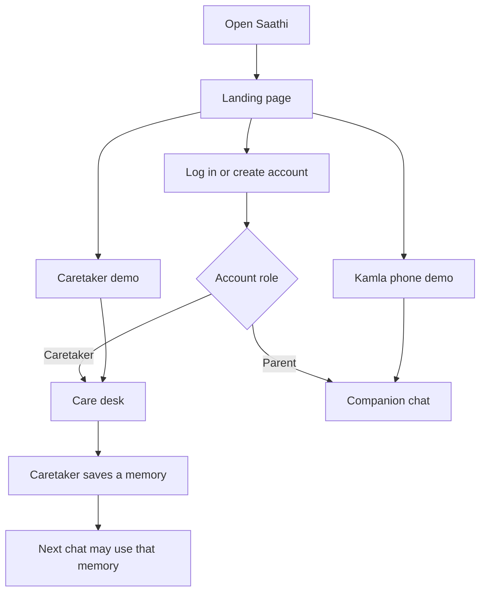
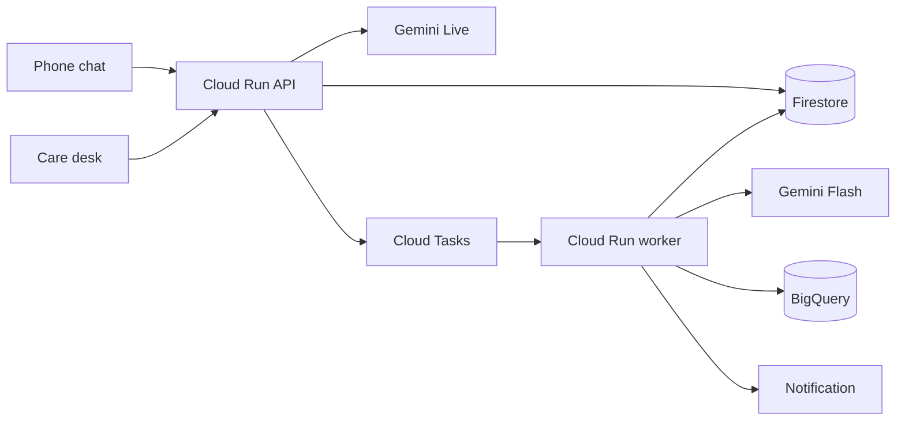

# Saathi

A Hindi companion for an older adult living apart from family. The family keeps the facts on a wide screen. The parent talks on a phone. Google Cloud does the listening, the memory, and the comparison across days.

The expensive minute is an open voice session. Gemini Live runs only inside a four-minute call. Gemini Flash does the work after the call. Cloud Run bills CPU while a request is active and scales to zero. Family memory uses Firestore vector search, so there is no warm vector index. The limits are in `api/src/saathi/cost.py`.

This repository is the AI Builder Cup 2026 prototype. Live voice, Firestore, BigQuery drift, SafetyGuard, and the insight run against a real Google Cloud project. What is checked and what is not is in [docs/PROGRESS.md](docs/PROGRESS.md).

## What you open



| Screen | Who | What they do |
| --- | --- | --- |
| Landing page, `/` | A new family, or a reviewer | Log in, create an account, or open either demo without an account |
| A few details, `/details` | Someone who just signed up with Google | Name, language, and city. Shown once, then the role's home |
| Care desk, `/care` | The caretaker, on a phone or a computer | Store the person's name, people, memories, check-in time, and reminders; read Routine; make a family code; switch among the family members they look after (up to 10) |
| Companion chat, `/app` | The older adult | Talk, stop, pause, contact the family, or ask for help nearby |

## How it runs



The closed phone does not listen. At the saved time the worker sends "Saathi wants to talk." Speech starts after the app opens.

Read the pictures and the rules in the docs:

| Doc | Question it answers |
| --- | --- |
| [docs/PROJECT_OVERVIEW.md](docs/PROJECT_OVERVIEW.md) | Executive summary, submission guide, and Google Cloud / Firebase integration breakdown |
| [docs/CODEBASE_FACTS_OPTIMIZATIONS_AND_STACK.md](docs/CODEBASE_FACTS_OPTIMIZATIONS_AND_STACK.md) | Deep technical blueprint, Gen AI latency optimizations, and cost-saving architecture |
| [docs/SPEC.md](docs/SPEC.md) | What are we building? |
| [docs/ARCHITECTURE.md](docs/ARCHITECTURE.md) | How are we building it? |
| [docs/MASTER_PLAN.md](docs/MASTER_PLAN.md) | What is locked, what is Sunday, what is later? |
| [docs/IMPLEMENTATION_PLAN.md](docs/IMPLEMENTATION_PLAN.md) | Which milestone happens on which day? |
| [docs/PROGRESS.md](docs/PROGRESS.md) | What is done right now? |
| [docs/DECISIONS.md](docs/DECISIONS.md) | Why these choices? |
| [docs/PRIVACY.md](docs/PRIVACY.md) | What is stored, and for how long? |
| [docs/ENVIRONMENT.md](docs/ENVIRONMENT.md) | Which project ids and URLs were actually checked? |

## Run it locally

Requires Python 3.12+ (or virtualenv) and Node 22+.

Using Makefile:
```bash
make setup     # Install Python dev dependencies and web node modules
make test      # Run all 100 unit and integration tests
make api       # Start public API on port 8080
make worker    # Start background worker on port 8081
make web       # Start Vite dev server on port 5173
```

Or manually:
```bash
python -m pip install -e "api[dev]"
python -m pytest api/tests
npm install --prefix web
```

Two terminals:

```bash
cd api && python -m uvicorn saathi.main:app --reload --host 127.0.0.1 --port 8080 --app-dir src
npm run dev --prefix web
```

Open `http://localhost:5173`. The landing page links to both demos. A caretaker account opens the care desk at `/care`; a parent account opens the chat at `/app`.

Copy `.env.example` to `.env` when a Google Cloud project id exists. Do not commit `.env`.

## What is finished

The product below is in the running app at https://saathi-511717.web.app. Open it with no account and try the Kamla Sharma phone or the caretaker demo. Both households are synthetic and labeled.

Saathi already knows the household before the parent speaks. The Live prompt is filled with the preferred name, the language, the city, every person who matters, the memories the family saved and the corrections from earlier talks, every reminder, the last conversation summaries, topics the parent declined, and one family thread when a named person has gone quiet. That packet is ready when the greeting starts, so the reply does not wait for a database read in the middle of a sentence. Voice audio is a live stream, not a file uploaded after the parent stops. The line to Gemini Live opens as the chat page opens. Talk sends "start" on a connection that is already up, and the greeting begins then. Microphone audio is 16 kHz PCM sent as it is captured. Saathi's voice comes back as 24 kHz PCM and is played gapless. If the parent talks over Saathi, the queued audio is dropped. The browser's audio context asks for interactive latency. Extraction, embeddings, and the drift comparison run after the call ends, on the worker, and never sit on the voice path.

| Capability | What a judge sees |
| --- | --- |
| Public app | https://saathi-511717.web.app, API `saathi-api`, private worker `saathi-worker` |
| Live conversation | Gemini Live `gemini-live-2.5-flash-native-audio`, voice Aoede, at most four minutes. Hindi in the Kamla demo. Nine more languages follow the profile: English, Bengali, Marathi, Gujarati, Punjabi, Tamil, Telugu, Kannada, Malayalam |
| Full context on every turn | Name, people, memories, reminders, recent summaries, declined topics, and the family thread are in the system instruction before the first word |
| Fast reply | Socket opened before Talk. PCM in and out with no upload step. Barge-in stops playback. Post-call work stays off this path |
| Memory across sessions | A fact the caretaker saves is in the next greeting. A correction from a conversation is kept beside it |
| Family episodes | Quotes stored with embeddings `text-multilingual-embedding-002` and found by Firestore vector search |
| Distress during the call | Keywords in every supported language, plus a short clip labeled by Flash. A door does not alert. "I did not fall" does not alert |
| Proactive check-in | At the saved time, a push says "Saathi wants to talk". An open chat greets without another tap. Later counts as a response. A blocked microphone is "device unavailable" |
| Push notifications | Firebase Cloud Messaging. The parent and the caretaker each turn them on from the app. The service worker shows the notice, and if the app is already open it speaks the line. A tap opens the chat and then speaks. The lock screen never carries a name, a quote, or a dose |
| Spoken "I have done it" | When a reminder is due and the parent agrees ("haan", "kar lunga", "ja raha hoon", "done"), that reminder is confirmed for today. A delivered push is only "seen". A bare "ji" is not agreement |
| Voice reminders | The parent can create one by talking. Saathi reads it back and saves it only after their own yes. Kinds: medicine, exercise, call, meal, other. Once or daily |
| Ask Saathi | The caretaker types or dictates a change. It is saved only after confirm. A question about how the parent has been is answered from stored facts and checked by SafetyGuard |
| Drift | BigQuery compares this person with their own earlier days. A named fast is not a nutrition alert. Eval of extraction: 30/30 labeled cases on `gemini-2.5-flash` |
| SafetyGuard | Every sentence the family sees is checked. A diagnosis, a dose, or an order to enter counselling is replaced by a sentence built from the stored facts |
| Insight | Three tools, in a fixed order, or an optional ADK agent that can only word the notice. The code chooses the tier and the evidence |
| Nearby help | Hospitals, medical shops, parks, and food, plus trusted people and 112, 108, and Elderline 14567. The parent taps Call |
| Several family members | One caretaker, up to 10 people, each with a desk and a family code |
| Phone that remembers | Redux holds the care desk and the slower reads. Both are written to versioned localStorage, shared across tabs of this browser, and cleared on log out. A reload opens on the saved copy. Private file links stay in memory only |
| Accounts and files | Email, password, and Google. Family code joins the phone. Photos and documents in a private bucket, opened with a 30-minute link |
| Installable phone app | Chrome install sheet. iPhone: Share, then Add to Home Screen. A closed app does not hold the microphone |
| On-phone word check | A distress word offers 112 with no network (`web/src/lib/edgeGemma.ts`). The badge names a browser model only when that model actually answered |
| MedGemma sample layout | Prototype only (`web/src/lib/medGemma.ts`). A live endpoint stays billed while it is on, about $2.30 an hour in us-central1 for the 4B quickstart, so it is not deployed. The desk shows a sample layout and does not read the file. A caretaker confirms anything before it is saved |
| Retention and spend stops | Transcripts 7 days, summaries and daily numbers 30 days. 120 Live minutes and 500 extraction calls a day. Three demo voice sessions a visitor a day |

### Not in this prototype

A live MedGemma endpoint (the care desk keeps a sample layout, because the endpoint stays billed while it is on), weekday recurrence (a reminder is once or daily), voice edit of every reminder field, Sutra as a full mode, Nest and Google Home, pill recognition, gas and glass detection, a Vertex AI Vector Search endpoint, Agent Engine hosting, Terraform, SMS, WhatsApp, a composite health score, a background wake word, and continuous room listening. The deck PDF and the three-minute video are the files that go with the form.

## What the judges score

The [AI Builder Cup 2026 criteria](https://aibuildercup.com/themes.html) are the same for every theme. Theme on the form: Sustainability and Social Impact. Category, if the form asks: Social Good. Submission materials are in English. The prototype must use Gemini or Gemma, or an agent platform, and must run on Cloud Run or Firebase. This build uses Gemini Live on Vertex, Cloud Run, and Firebase Hosting. MedGemma stays a sample layout because a live endpoint is billed the whole time it is deployed.

Weights and the pieces of this repository that answer them:

| Weight | Criterion | What is in this build |
| --- | --- | --- |
| 40% | Technical merit and Gen AI | **Gemini Live** holds the voice conversation on Cloud Run, with the household already in the prompt and the socket open before Talk. Gemini Flash extracts observations, labels a short impact clip, drafts the family notice, and answers a caretaker's question from stored facts. Optional ADK `LlmAgent` words the notice; the fixed-order tools remain the fallback. Embeddings and Firestore vector search recall family episodes. BigQuery SQL compares this person with their own earlier days, including pause and speaking pace. A distress word on the phone offers 112 with no network, and names a browser model only when that model answered. MedGemma is a sample layout: the live endpoint was not deployed because it stays billed while it is on. Five Live tools act during the call. The public API and the private worker are one image on Cloud Run. Cloud Tasks, Cloud Scheduler, Firebase Auth, Firestore, Cloud Storage, FCM, and Secret Manager are in the running app. The API tests cover safety, drift, the live bridge, reminders, nearby help, family members, push registration, and quota |
| 25% | Problem alignment and impact | An older adult living apart can talk without filling a form. The family sees what changed, in the parent's words, and a human next step. Check-ins, distress, unanswered invitations, and a shift in family contact each have a rule. Nearby help offers 112 first, then a place or a trusted person, and never a diagnosis or a dose. Research numbers on the slides are cited as other people's results. This prototype does not claim fewer deaths, hospital days, or insurance claims |
| 25% | Innovation | The phone offers 112 from a distress word with no network. The cloud line is a live audio stream with memories and reminders pre-loaded. The closed phone does not listen: a notification, then speech. The drift rule uses this person's own baseline, draws pause and speaking pace on the same days, and does not treat a named fast as a missed meal. After a drift flag or a distress notice, the desk offers 112, Elderline 14567, and the nearby trusted contact, and the parent taps Call. The family-episode card needs two quotes and a coded shift. A reminder is saved only after a spoken yes, and a later "I have done it" confirms it. A push is "seen". SafetyGuard replaces a diagnosis, a dose, or an order to enter counselling. Late at night the prompt drops memories and outings |
| 10% | User experience | One app, two fronts chosen by role. The parent's screen is Talk, Stop, Pause, Contact family, and Nearby help, with optional captions. The badge says "On-phone word check" until a browser model actually answers. The care desk is five tabs on a phone and on a computer, and it opens on the copy already saved in the browser. A family code joins the phone. Chrome gets an install sheet; iPhone gets Add to Home Screen steps. Copy stays plain: "Not yet confirmed" until the parent says they have done it |

Try it at https://saathi-511717.web.app. The Kamla Sharma phone and the caretaker demo need no account. Both are labeled synthetic.

## Deploy

```bash
powershell -File deployment/scripts/setup_cloud.ps1
powershell -File deployment/scripts/deploy.ps1
python scripts/smoke_cloud.py --invoke
```

`setup_cloud.ps1` runs once: the signing secret, the service-account grants, and the two Scheduler jobs. `deploy.ps1` builds one image for both Cloud Run services and deploys Hosting.

Owners: Srushti Patil and Vibhuti Singh. Theme: Sustainability and Social Impact.
