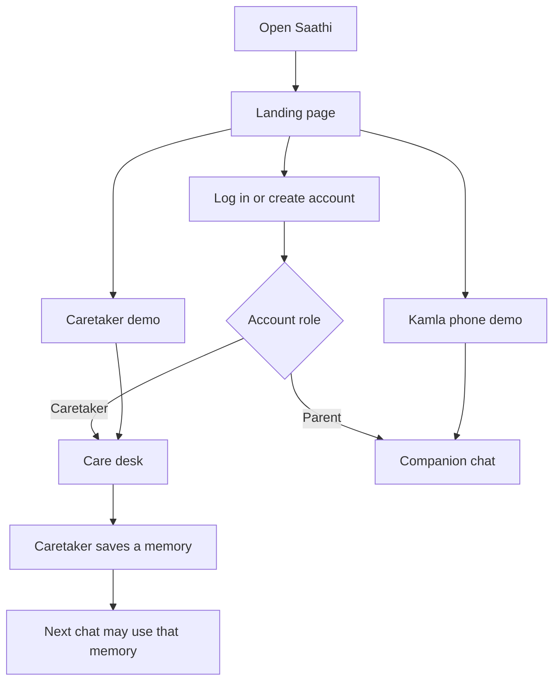
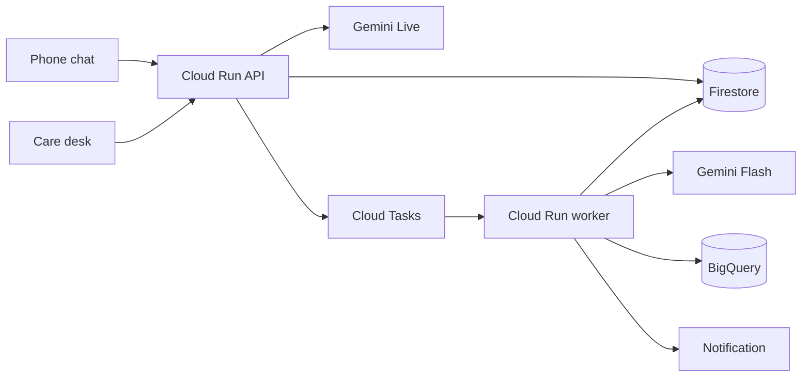

# Saathi

A Hindi companion for an older adult living apart from family. The family keeps the facts on a wide screen. The parent talks on a phone. Google Cloud does the listening, the memory, and the comparison across days.

The expensive minute is an open voice session. Gemini Live runs only inside a four-minute call. Gemini Flash does the work after the call. Cloud Run bills CPU while a request is active and scales to zero. Family memory uses Firestore vector search, so there is no warm vector index. The limits are in `api/src/saathi/cost.py`.

This repository is the AI Builder Cup 2026 prototype. Live voice, Firestore, BigQuery drift, SafetyGuard, and the insight run against a real Google Cloud project. What is checked and what is not is in [docs/PROGRESS.md](docs/PROGRESS.md).

## What you open



| Screen | Who | What they do |
| --- | --- | --- |
| Landing page, `/` | A new family, or a reviewer | Log in, create an account, or open either demo without an account |
| Care desk, `/care` | The caretaker, on a phone or a computer | Store the person's name, people, memories, check-in time, and reminders; read Routine; make a family code |
| Companion chat, `/app` | The older adult | Talk, stop, pause, or contact the family |

## How it runs



The closed phone does not listen. At the saved time the worker sends "Saathi wants to talk." Speech starts after the app opens.

Read the pictures and the rules in the docs:

| Doc | Question it answers |
| --- | --- |
| [docs/SPEC.md](docs/SPEC.md) | What are we building? |
| [docs/ARCHITECTURE.md](docs/ARCHITECTURE.md) | How are we building it? |
| [docs/MASTER_PLAN.md](docs/MASTER_PLAN.md) | What is locked, what is Sunday, what is later? |
| [docs/IMPLEMENTATION_PLAN.md](docs/IMPLEMENTATION_PLAN.md) | Which milestone happens on which day? |
| [docs/PROGRESS.md](docs/PROGRESS.md) | What is done right now? |

## Run it locally

Requires Python 3.12 and Node 22.

```bash
python -m pip install -e "api[dev]"
python -m pytest api/tests
npm install --prefix web
```

Two terminals:

```bash
cd api && python -m uvicorn saathi.main:app --reload --host 127.0.0.1 --port 8080 --app-dir src
npm run dev --prefix web
```

Open `http://localhost:5173`. The landing page links to both demos. A caretaker account opens the care desk at `/care`; a parent account opens the chat at `/app`.

Copy `.env.example` to `.env` when a Google Cloud project id exists. Do not commit `.env`.

## Status

| Piece | State |
| --- | --- |
| Landing page, care desk, chat, accounts, family code | Built |
| Gemini Live voice, post-call extraction, family episodes, drift, SafetyGuard, insight | Built, checked against real Vertex, Firestore, and BigQuery |
| Cloud Tasks queue, worker service, Cloud Scheduler, public URL | Code ready; not recorded as created or verified |
| FCM push on a real phone, real installed PWA | Not verified |
| Nest speaker | Milestone M16, after submission |

Owners: Vibhuti Singh and Srushti Patil. Theme: Sustainability and Social Impact.
