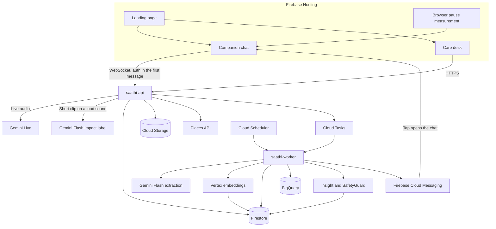
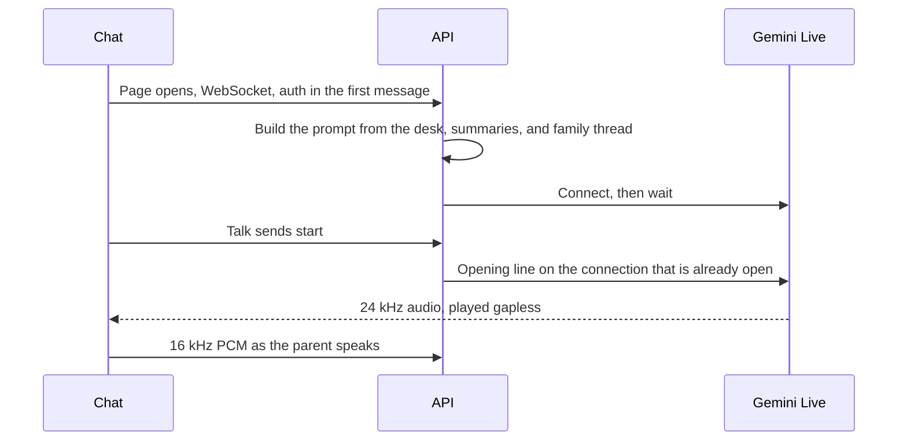
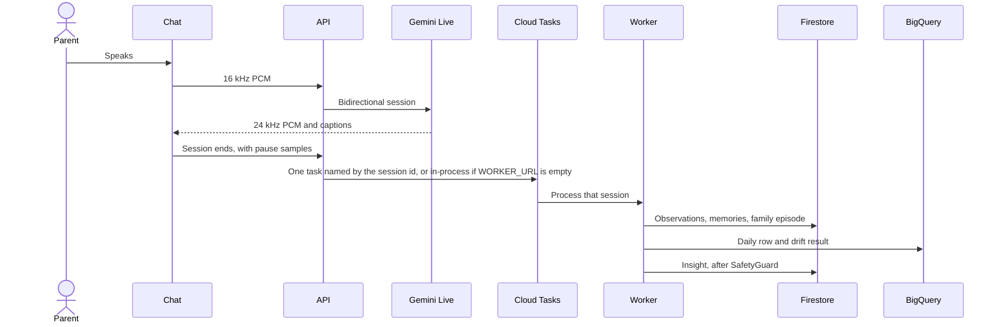
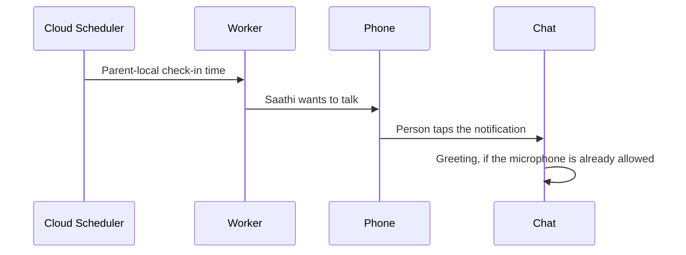

# How Saathi is built

One React app on Firebase Hosting. One Python image on Cloud Run, started twice: a public API and a private worker. Gemini Live holds the conversation. Gemini Flash reads the transcript afterward, labels a short impact clip, and drafts family-facing sentences. Firestore holds the household and the account profile. Cloud Storage holds photos and documents. BigQuery holds the daily numbers. The Places API answers "what is near me." The URLs that were checked are in [ENVIRONMENT.md](ENVIRONMENT.md).

The running tree includes the landing page, role-based care desk and companion chat, Live voice, post-call extraction, household sync, accounts, file uploads, nearby help, and several family members on one caretaker account. `GET /health` on the API reports `stage: "connected"` and the configured `live_model`. Cloud Tasks and Cloud Scheduler are in the code and, as of the check in [ENVIRONMENT.md](ENVIRONMENT.md), created in the project. When `WORKER_URL` is empty, the post-call work runs in the API process. [SPEC.md](SPEC.md) says what the product does. [IMPLEMENTATION_PLAN.md](IMPLEMENTATION_PLAN.md) says the order.

## The running system



Voice does not wait for extraction. A distress check does: during the open call the API speaks that language's check (in Hindi, "Kya hua? Gir gaye kya? Main yahin hoon.") and may send a short clip to Flash. Embeddings and drift run after the call. With no `WORKER_URL`, that post-call work stays in the API process instead of Cloud Tasks.

## Two services, one image

| Service | Who can call it | First size |
| --- | --- | --- |
| `saathi-api` | Browsers. Household routes check a Firebase token on the API | 1 vCPU, 512 MiB, timeout 600 seconds, concurrency 8 |
| `saathi-worker` | Cloud Scheduler and Cloud Tasks, with OIDC | 1 vCPU, 1 GiB, concurrency 1, max 1 instance |

`APP_MODULE` selects `main:app` or `worker:app`. The WebSocket goes to the Cloud Run URL. Firebase Hosting serves the static app and does not carry the audio socket.

Minimum instances stay at 0. Startup CPU boost covers the cold start. A temporary minimum of 1 on the API is only for the hour the demo is recorded, then it goes back to 0. Session state is in Firestore, so the API does not pin a visitor to one instance.

## Spend shape

The bill is dominated by open Gemini Live minutes. Everything else is chosen so it can sit at zero between calls.

| Latest feature we use | Why it is the cheap correct one |
| --- | --- |
| Gemini Live `gemini-live-2.5-flash-native-audio`, voice `Aoede`, capped at 240 seconds | Voice only while someone is talking. The socket closes and the microphone is released. These are the defaults in `config.py`; environment variables can override the ids |
| Gemini Flash `gemini-2.5-flash` for the clip label, extraction, and the insight | Flash is the small model. Live is not asked to return JSON |
| Embeddings `text-multilingual-embedding-002` | Family episodes, nearest neighbours inside the household |
| No explicit context cache on the Live path | `use_explicit_context_cache` would allow one only at 4,096 tokens or more. The Live path does not call it, and prompts are not padded. This build has not measured a Gemini 3 discount |
| Cloud Run request-based CPU, scale to zero, startup CPU boost | CPU is billed while a request is active, including an open voice socket, and not while the service is idle. https://docs.cloud.google.com/run/docs/ai/use-cases |
| Firestore vector search, nearest 5, household filter | A household has dozens of episodes. Reads are per query. A Vertex AI Vector Search endpoint bills for warm replicas and does not scale to zero |
| BigQuery on-demand, partitioned by local date, `maximum_bytes_billed` of 100 MiB | The comparison reads a short window. No slot reservation and no trained model |
| Cloud Tasks named by session id | A retry does not run Gemini twice for the same call |
| Firebase Hosting and Cloud Messaging | The site is static. A push replaces SMS |
| Optional ADK inside the worker process, with a fixed-order fallback | No Agent Engine replica |
| Places API (New), 5 km, at most 5 results, cached one hour in the API process | A lookup only when someone asks what is nearby. Helplines and trusted people do not call Places |

Features that are current and that this prototype leaves off, because they raise the bill without helping the demo: Cloud Run GPUs, a Vector Search index with replicas, Agent Engine, Gemini provisioned throughput, BigQuery editions, and a Live socket that stays open between visits.

Application counters stop the project at 120 Live minutes a day and 500 Flash extraction calls a day. `DEMO_SESSIONS_PER_VISITOR` is 3. The live route counts a demo voice session when Talk starts (`usage.py`); `0` turns that visitor cap off. The drift query sets `maximum_bytes_billed` from `BIGQUERY_MAX_BYTES_BILLED`. `deployment/scripts/bootstrap_cloud.sh` tells you to create a monthly budget alert. It does not create one. An alert is a warning, not a hard stop, so the counters above are the stop.

Firestore's free plan is 50,000 reads and 20,000 writes a day. The API keeps short-lived copies of desk reads (`cache.py`: alerts 20 seconds, slower updates 60 seconds, daily numbers 2 minutes). An open tab that nobody touches polls more slowly (`web/src/lib/activity.ts`). A quota error becomes HTTP 503 with `Retry-After` (`quota_paused` on the API, 300 seconds on the worker) so the browser keeps the person's edits on the device and Cloud Tasks retries later. Places results are cached in the API process for one hour.

The Live model has five tools, all executed in the API for the household that opened the socket: `propose_reminder`, `confirm_reminder`, `get_family_context`, `find_nearby`, and `offer_call`. `find_nearby` calls the Places API (New) for hospitals, pharmacies, parks, and restaurants within 5 km, at most 5 results, and also returns trusted contacts and the helplines 112, 108, and 14567. If Places is disabled or the call fails, places come back empty with `available: false`; helplines and trusted people still return. `offer_call` puts a Call button on the phone. The number is resolved from stored data. The model does not dial. After 9 pm a park lookup is refused. The parent's position is one point rounded to three decimals (about 100 m) at `households/<id>/place/current`. The shared demo never stores a position. Without one, search uses the city on the desk.

A caretaker's first household id is their email. `POST /api/v1/me/households` adds further members, up to 10, each with id `hh-...`, its own desk, and its own family code. The list is written only by that route. A profile save cannot attach a household the account does not own.

`deployment/scripts/deploy.sh` prints this shape and does not deploy unless `CONFIRM_DEPLOY=1`. The limits live in `api/src/saathi/cost.py`. API `GET /health` reports `billing`, `min_instances`, `session_cap_seconds`, `stage`, and `live_model`.

## A fast reply, with the household already loaded

The expensive wait in a voice product is opening the model and then looking up who the person is. Saathi does both before the parent speaks.



The browser uses an `AudioContext` with `latencyHint: "interactive"` and an AudioWorklet. Chunks are scheduled back to back. An interruption from the model, or the parent talking over Saathi, drops whatever is still queued. End-of-speech uses a 700 ms silence and a short prefix, with a high sensitivity for the start of speech, so a reply can begin as the sentence ends. A sliding window on the Live session keeps a long call inside the model window. The shared Gemini client is opened at API startup.

Nothing after the call is on this path. Extraction, embeddings, BigQuery, and the insight run on the worker once the socket has closed.

## What the phone keeps

The care desk and the chat read through a Redux store (`web/src/store`). Two slices:

| Slice | Holds | Written to |
| --- | --- | --- |
| `care` | The desk, routine updates, daily numbers, and the family code, per household | `localStorage` key `saathi.care:v1` |
| `reads` | Nearby places, the file list, upload categories, and the list of family members | `localStorage` key `saathi.reads:v1` |

A reload paints the saved copy and asks the server only when that copy is older than its limit (15 minutes for a real desk, 30 seconds for the shared demo). Another tab of the same browser picks up a save through the `storage` event instead of fetching again. Log out deletes both keys. Signed links to private files stay in memory and are never written to `localStorage`. If Firestore answers that the daily quota is used up, the API returns 503 and the desk keeps the person's edits on the device until the next save succeeds.

The account session, the dismissed install sheet, and the location choice (allowed or skipped) are separate versioned keys. They are not the household record. Firestore is.

## One conversation



Audio in is 16 kHz signed 16-bit mono PCM. Audio out is 24 kHz PCM. The session ends at 240 seconds. The browser reconnects if the socket drops. Session state lives in Firestore, not in the instance.

The first WebSocket message is the Firebase auth payload. The token is not placed in the URL.

## Check-in when the phone is closed



Chrome on Android can show an Install Saathi sheet from `beforeinstallprompt`. iPhone has no install-prompt API, so the app shows Share, then Add to Home Screen. Periodic background sync may refresh a token. It does not start a conversation.

## Where each fact lives

| Store | Holds | Does not hold |
| --- | --- | --- |
| Firestore | Profile, people, memories, sessions, episodes and their vectors, reminders, insights, jobs, account docs at `users/<uid>` (including the list of extra households), file metadata at `households/<id>/files`, one rounded position at `households/<id>/place/current`, daily usage counters at `_usage/<day>` | Direct browser access. Rules deny every client read and write |
| Cloud Storage | Photos and documents under `caretaker` or `person`, then `public` or `private`, the uploader id, the category, and a random file name. Bucket name is `UPLOADS_BUCKET`, or `{project}-media` when that is empty | A public bucket. Private files open only through a 30-minute signed API link. Medical and identity categories are always private |
| BigQuery `saathi` | Daily metrics and drift results, partitioned by local date | Quotes, names, medicine labels, transcripts |
| Browser | Redux copies of the desk and of nearby places, files, and family members, written to versioned localStorage and shared across tabs. The pause measurement for the current session | A wake word while the app is closed. The household record of truth. Private file links |
| Cloud Tasks | One post-call job per session, when `WORKER_URL` is set | A second copy of the same pipeline via Pub/Sub or Eventarc. When `WORKER_URL` is empty the API runs the same job in-process |

Family episodes use Vertex embeddings and Firestore vector search, filtered to that household. A deployed Vertex AI Vector Search endpoint is a later scale path, not the Sunday index.

The insight path always has three tools: `get_recent_metrics`, `compose_family_insight` (SafetyGuard on every caregiver sentence), and `send_alert`. The default is that fixed order inside the worker. An ADK `root_agent` runs only when `google-adk` is installed (`pip install -e "api[adk]"`) and `INSIGHT_USE_ADK` is not turned off. A failure falls back to the fixed order. Tier 1 does not call the agent. The model does not choose the household id, the tier, or the evidence ids. The five Live tools above are separate: they run in the API during the call, and they can only see the household the socket was authorized for.

## Drift rule

For a continuous measure such as response gap:

`z = (mean of the latest 3 local days - mean of the prior 11 days) / baseline standard deviation`

The latest 3 days are not part of the baseline. Fewer than 7 baseline days means the desk shows "Learning usual routine." The divisor uses a floor so a flat baseline cannot explode. Thresholds in this prototype are demonstration settings, not clinical cutoffs.

## Repository

```text
api/src/saathi/          Python API and worker
  accounts/              Profile, and extra households for one caretaker
  files/                 Cloud Storage uploads and 30-minute links
  households/            Desk, pairing, updates, Ask Saathi
  live/                  Live bridge, prompts, distress, five tools
  nearby/                Places API, helplines, rounded position
  insights/ providers/   SafetyGuard, optional ADK, and Google clients
  languages.py           Ten languages: prompt line and server phrases
  cache.py usage.py      Short-lived reads, and the daily spend counters
  pipeline.py            Post-call extraction, drift, and insight
web/src/                 React app: landing, care desk, chat, nearby
web/public/              Manifest, service worker, PCM worklet
docs/                    These documents
deployment/scripts/      Cloud bootstrap and deploy
eval/                    30 labeled extraction cases
```

Google client libraries live in `providers`. Product rules stay in pure functions so the tests do not need a network.

## Local run

Using Makefile:
```bash
make setup     # Install dependencies
make test      # Run all 100 pytest tests
make api       # Run public API on port 8080
make worker    # Run background worker on port 8081
make web       # Run Vite dev server on port 5173
```

Or manually:
```bash
python -m pip install -e "api[dev]"
python -m pytest api/tests
cd api && python -m uvicorn saathi.main:app --reload --port 8080 --app-dir src
npm install --prefix web && npm run dev --prefix web
```

For a comprehensive submission breakdown of the Google Cloud, Firebase, and Gemini stack, see [PROJECT_OVERVIEW.md](PROJECT_OVERVIEW.md).

The page reads `/health` through the Vite proxy. Live voice, Firestore, BigQuery, and Cloud Storage run when project credentials are present. Without `WORKER_URL`, post-call work stays in the API process. A build that is not behind the proxy can set `VITE_API_URL`. Optional ADK is `pip install -e "api[adk]"`.

## What this build will not claim

| Wish | What is true |
| --- | --- |
| The phone listens like "Ok Google" | A website cannot hold the microphone while it is closed |
| "Hey Google, talk to my companion" on a Nest Hub | Conversational Actions ended on 13 June 2023 |
| Home Graph wakes the speaker and reads a care script | Home Graph stores device state. It does not host this conversation |
| The app reads WhatsApp | Family news comes from what the parent tells Saathi, and from what the caretaker types |

A Nest speaker is [milestone M16](MASTER_PLAN.md#m16-after-submission). Until that work is done on hardware the team owns, the deck says roadmap.
