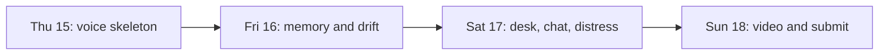

# Implementation plan

Order of work for 15 to 18 Oct 2026. Behavior is in [SPEC.md](SPEC.md). The system is in [ARCHITECTURE.md](ARCHITECTURE.md). Priority is in [MASTER_PLAN.md](MASTER_PLAN.md).

| Day | Build | Stop when |
| --- | --- | --- |
| Thu 15 Oct | Project skeleton, health on a public URL, one Hindi turn, worker rejects an anonymous call | `docs/ENVIRONMENT.md` has the model ids that passed |
| Fri 16 Oct | Extraction, caretaker and chat memory, family episodes and embeddings, pause measurement, BigQuery drift, SafetyGuard, three ADK tools | One session writes an observation, a nearest episode, a BigQuery row, and an insight that passes the guard |
| Sat 17 Oct | Proactive greeting, distress check, once or daily reminder with a spoken confirm, both fronts, install path, notification tap | A parent opens `/app` and a caretaker opens `/care`. A caretaker memory shows up in the next greeting. "Ouch" asks "Kya hua?" |
| Sun 18 Oct | Feature freeze in the morning. Demo isolation, video, PDF, public repo, second browser | Receipt saved. Leave hours before the portal cutoff |

If Thursday's voice session does not connect, Friday morning is still voice.

## Status as of 16 Oct 2026

Voice, extraction, the care desk, companion chat, accounts, and file uploads are in the tree. What is still open, and must not be marked done from reading the code: a verified public URL, the Cloud Tasks queue, the worker service, and the Cloud Scheduler job (empty `WORKER_URL` runs post-call work in-process), FCM on a real device, and the Sunday feature freeze, video, and submission. See [PROGRESS.md](PROGRESS.md).

## Milestones

| Id | Result |
| --- | --- |
| M01 | Cloud project checked. API and web run locally and `/health` reports `stage: connected`. A public deploy is a separate check and is not recorded as done |
| M02 | Household, consent, pairing, judge demo without an account form |
| M03 | Hindi Live bridge, Talk / Stop / Pause / Contact family |
| M04 | Extraction, memory, family episodes, vector index |
| M05 | Browser pause and speaking-rate measurement |
| M06 | Proactive invitation, snooze, unanswered versus device unavailable |
| M07 | Reminder records, once and daily, from the care desk |
| M08 | Voice create and confirm |
| M09 | BigQuery daily rows and the SQL drift rule |
| M10 | SafetyGuard, ADK insight, immediate contact path |
| M11 | Care desk cards, including caretaker memories |
| M12 | In-app alert, then FCM if the in-app path is solid |
| M13 | Labeled synthetic household and demo clock |
| M14 | Video, deck, public repo, submission receipt |
| M15 | PWA manifest, install sheet or iPhone instructions, notification opens the chat |
| M16 | Nest speaker. Starts only after M14 is submitted |

M01 through M05, M09, M10, M11, M13, and M14 are the P0 line, together with the landing page and both layouts. M06, M07, M08, M12, and M15 are P1. M16 is after Sunday.

The original fourteen-milestone note used M01 to M14 for a deeper reminder and notification design. This calendar keeps those numbers and adds M15 for the installable phone app and M16 for Nest, which the master plan already set aside.

## Checks after each slice

Write the command and the real result in [PROGRESS.md](PROGRESS.md). Do not mark a browser check passed by reading the code.

| Check | Proves |
| --- | --- |
| `python -m pytest api/tests` | Health, safety, drift, live, pipeline, scheduling, files, and household access. 75 tests collected on 16 Oct 2026; the last recorded green run is 71 passed |
| Safety tests | Diagnosis, dose advice, and an order to enter counselling are rejected |
| Drift fixtures | Stable, changing, fasting, and family-shift histories |
| A real browser | Hindi audio, parent chat versus caretaker desk, and the health line on the demo page |

## Submission pack

- Deployed URL that opens in a fresh window on a phone and on a laptop
- Public GitHub repo, English README, green tests
- PDF deck
- Public video under 3 minutes
- Theme on the form: Sustainability and Social Impact
