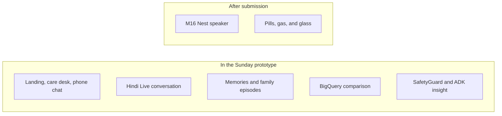

# Master plan

Decision record for the Sunday 18 Oct 2026 submission. Product detail is in [SPEC.md](SPEC.md). The system picture is in [ARCHITECTURE.md](ARCHITECTURE.md). The day-by-day order is in [IMPLEMENTATION_PLAN.md](IMPLEMENTATION_PLAN.md).

Owners: Srushti Patil and Vibhuti Singh. Theme: Sustainability and Social Impact. If the form also asks for a category, choose Social Good.

This file matches the locked choices in the planning notes. If an older note disagrees, follow this file for priority and claims, and follow SPEC.md for behavior.

## Sunday, in one picture

## Locked choices

| Topic | Choice |
| --- | --- |
| Models | Live `gemini-live-2.5-flash-native-audio` (voice `Aoede`). Extract and insight `gemini-2.5-flash`. Embeddings `text-multilingual-embedding-002`. These are the defaults a Live smoke actually used. Environment variables can override them |
| Voice path | Browser to Cloud Run WebSocket to Vertex Live. Auth is the first socket message |
| After the call | One Cloud Task per session, then the private worker. Scheduler once a minute for due work. No second Pub/Sub path |
| Memory | Firestore, including caretaker facts. Family episodes also get a Vertex embedding and a Firestore vector index |
| Drift | SQL in BigQuery. Recent 3 local days against the prior 11. At least 7 baseline days |
| Speech timing | The browser sends the wait from the parent's last loud frame to the first reply audio, and a speaking pace from the parent's words over that loud time. Live does not emit either number |
| Safety | A Python check on every family-facing sentence. Failure falls back to a sentence built from stored facts |
| Agent | Three tools in the worker. The default path runs them in a fixed order. ADK is optional (`saathi[adk]`) and falls back to that order. Agent Engine hosting is out |
| Cost | Request-billed Cloud Run at zero instances. Live capped at 240 seconds. Flash for everything after the call. Explicit cache only at 4,096 tokens or more, and the Live path does not create one. Firestore vectors, not a Vector Search replica. BigQuery on-demand, 100 MiB byte cap. No GPU |
| Screens | Landing page, with both demos. Caretaker app at `/care` (sidebar at 1024px and wider, bottom tabs below that). Parent chat at `/app` |
| Phone check-in | A notification, then speech in the open app. No background microphone |
| Nest | Milestone M16, after submission |
| Alerts | Firebase Cloud Messaging. Check-in text and caretaker text stay generic |
| Language | Hindi in the Kamla demo. The profile can also be English, Bengali, Marathi, Gujarati, Punjabi, Tamil, Telugu, Kannada, or Malayalam. The Live prompt and the server's own phrases follow that choice. Submission text is English |
| Nearby help | Places API (New) for hospitals, pharmacies, parks, and restaurants. Helplines 112, 108, and 14567, and trusted contacts, do not depend on Places. The parent taps Call. Position is one rounded point, or the city on the desk |
| Family members | One caretaker account, up to 10 households, each with its own desk and family code |
| Research numbers | Holt-Lunstad 2015, WHO 2025, and LASI, each labeled as someone else's research |

## What the running app shows

These are finished. A reviewer can do them on https://saathi-511717.web.app.

| # | Finished |
| --- | --- |
| 1 | A Hindi Live turn on the deployed app. The socket is open before Talk, and the household is already in the prompt |
| 2 | A parent at any width sees the chat at `/app`. A caretaker sees the care desk at `/care`. The landing page has login, signup, and both demos |
| 3 | An open, permitted chat greets without a new parent tap. A closed app gets a push, then speaks after it opens |
| 4 | Snooze counts as a response. Two unanswered invitations make one notice. A blocked mic is a different status |
| 5 | Extraction keeps negation and talk about someone else unknown |
| 6 | A fact from one session appears in the next. A correction stays beside the caretaker's memory |
| 7 | A family-episode card shows an earlier quote and a later quote |
| 8 | A session writes the browser's pause in milliseconds, with a quality flag |
| 9 | Seeded stable, changing, and fasting histories disagree in the expected way |
| 10 | Safety tests replace a diagnosis and a dose suggestion with a factual sentence |
| 11 | The insight cites stored evidence. A caretaker memory can appear in the next greeting |
| 12 | A confirmed voice reminder creates one record. "Haan, I have done it" confirms a due reminder. Uncertain medicine status never suggests another dose |
| 13 | Help, Contact family, or the distress rule notifies without waiting for BigQuery |
| 14 | The Kamla Sharma demo needs no account. A seeded session still runs if the mic is denied |
| 15 | Chrome install sheet or iPhone Add to Home Screen instructions. A closed app does not take the microphone |
| 16 | Push on the parent's phone and the caretaker's desk. The phone keeps the desk in Redux and localStorage |
| 17 | Nearby help, ten languages, up to 10 family members, and Ask Saathi answers from stored facts |

The English deck and the public video are the files that go with the form. They are not a missing product feature. Nest, pill recognition, gas, glass, and WhatsApp are not in this app.

## Cut line

| Tier | Keep | Rule |
| --- | --- | --- |
| P0 | Voice, landing and both fronts, extraction, family episodes, pause measurement, drift, SafetyGuard, ADK insight, demo button, submission pack | If one of these is missing, do not start the next tier |
| P1 | Proactive invitation, distress clips, once and daily reminders, voice confirm, install sheet, notification tap | A keyword distress check still counts if the impact model is late |
| P2 | Weekday edge cases, speaker checks for languages other than Hindi, Terraform, ARIMA as a second query, M16 Nest | After the URL already tells the story |

## Claims that stay out of the pitch

Sub-800 ms as a guarantee. A diagnosis. "She needs counselling." "We detected a fall" when the event was only a noise. A microphone that is always on. An installed app that listens like Ok Google. "Hey Google, talk to my companion" as a shipped feature. Reading WhatsApp. A Nest that detected inactivity. Rat Park as evidence about older adults. An ARIMA model that proved decline. A 60-second audio purge unless the code does that. DPDP or HIPAA certification. A percentage reduction in hospital claims. "She is safe."

## M16, after submission

The experience to reach, if a current Google API allows it:

1. A check-in or a desk button speaks a short line on one speaker the family chose.
2. The person can start Saathi from that speaker, using the same memories as the phone.
3. The installed app is where the family links the account and picks the device.

Checked on 15 Oct 2026, these do not provide that conversation:

| Idea | What it is |
| --- | --- |
| "Hey Google, talk to my companion" | Conversational Actions ended on 13 June 2023. https://developers.google.com/assistant/ca-sunset |
| App Actions | Android shortcuts. They do not stream Gemini to a Nest Hub |
| Local Home SDK and Cloud-to-cloud | Device commands and reported state. Home Graph does not read a care script |
| Smart-home notifications | A device announcement, if the user enabled them. Not an open Gemini session. https://developers.home.google.com/cloud-to-cloud/integration/notifications |

M16 starts by reading the Home docs again that week. If custom conversation routing is still closed, the only slice is a short announcement, and the Gemini session stays in Saathi. The Sunday demo does not show a Nest.
