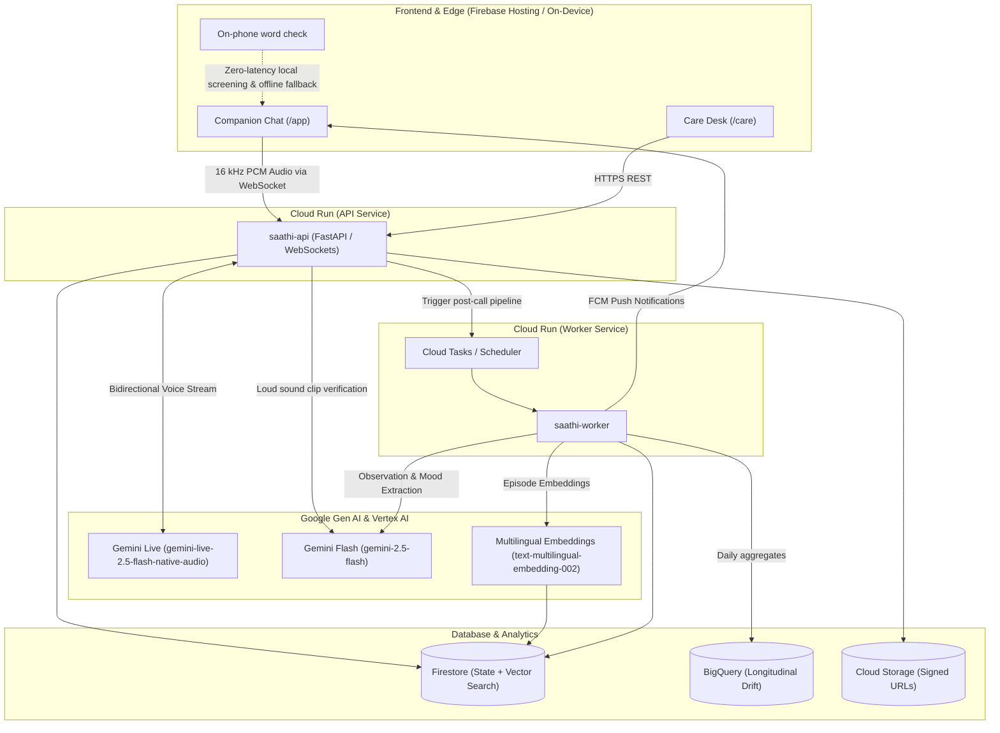

# Saathi: Project Overview & Submission Guide

**Theme**: Sustainability and Social Impact (Social Good)  
**Hackathon**: AI Builder Cup 2026  
**Project Leads**: Srushti Patil & Vibhuti Singh 
**Live Application**: [https://saathi-511717.web.app](https://saathi-511717.web.app)  

---

## 1. Executive Summary

**Saathi** is an intelligent, proactive companion designed for elderly parents living independently while their adult children work in distant cities. 

In traditional digital healthcare and communication tools, older adults are forced to navigate complicated menus, type text, or fill out structured forms—barriers that lead to abandonment and isolation. Saathi fundamentally re-engineers this dynamic:
- **For the Parent**: Zero typing and zero forms. Saathi engages in warm, natural, low-latency spoken conversations in their native language (Hindi default, plus 9 other Indic languages). Saathi speaks first via scheduled check-ins, actively listens, remembers family members, confirms routines, and detects signs of distress.
- **For the Caretaker**: A dedicated **Care Desk** web application (`/care`) that provides visibility into daily routine adherence, subtle health/lifestyle drift across weeks, verified family episode memories, and urgent notifications—without invasive surveillance.

### Privacy & Safety First
- **No Background Listening**: A closed phone never records. Check-ins arrive as polite push notifications ("Saathi wants to talk"). The microphone is active only while the app is open and the user is speaking.
- **Strict SafetyGuard**: Automated clinical safety filters ensure caregiver-facing text never hallucinates diagnoses, recommends medication dosages, or directs counseling.

---

## 2. Core Architecture & Google Cloud / Firebase Stack

Saathi is architected natively around the Google Cloud and Firebase ecosystem, delivering an interactive, real-time voice experience coupled with an asynchronous, cost-efficient post-conversation intelligence pipeline.

---

## 3. How We Leverage Key Google Technologies

### A. Gemini & Gemma (Multi-Tier Google AI Ecosystem)
Saathi pairs specialized Google AI models tailored to latency, safety, and domain requirements:

1. **On-phone word check (`web/src/lib/edgeGemma.ts`)**:
   - A distress word offers 112 with no network.
   - The badge names a browser model only when Chrome's built-in language model actually returns an answer. WebGPU being present is not that model.

2. **MedGemma (`web/src/lib/medGemma.ts`) — prototype, not deployed**:
   - The planned reader for one uploaded prescription.
   - On Model Garden that endpoint is billed the whole time it is deployed, about $2.30 an hour in us-central1 for the 4B quickstart, including idle time. It is not deployed.
   - The care desk shows a sample layout and does not read the file. A caretaker still confirms any routine before it is saved.

3. **Gemini Live (`gemini-live-2.5-flash-native-audio`)**:
   - **Real-Time Voice Streaming**: Connects directly via bidirectional WebSockets. Audio captured at 16 kHz PCM is streamed to Gemini Live, which returns natural 24 kHz spoken audio streamed gapless to the browser.
   - **Zero-Wait Context Injection**: Before the opening word is spoken, the API pre-populates Gemini Live's system prompt with the household's profile, loved ones, custom memories, routine reminders, recent conversation summaries, and active family threads.
   - **Conversational Function Calling (Tools)**: Gemini Live executes tools on the fly:
     - `propose_reminder`: Suggests reminders dictated verbally by the parent.
     - `confirm_reminder`: Confirms when the parent says they completed a task ("Haan, maine le li").
     - `find_nearby`: Leverages Google Places API for nearby essentials.
     - `offer_call`: Generates one-tap calling buttons for trusted family or emergency helplines.
   - **Natural Barge-In**: Instant response cutoff when the user speaks over the companion.

4. **Gemini Flash (`gemini-2.5-flash`)**:
   - **Post-Call Fact Extraction**: Once the voice socket closes, Gemini Flash asynchronously parses the conversation to extract structured observations (meals, sleep, pain mentions), reminder statuses, and emotional sentiment. Evaluated at 100% (30/30) accuracy across conversational edge cases.
   - **Sound & Distress Classification**: When sudden loud audio spikes occur, Flash evaluates the audio snippet to distinguish benign sounds (door slamming) from potential distress events, triggering caregiver checks.
   - **"Ask Saathi" Grounded Q&A**: Caregivers can ask plain-text questions on the Care Desk; Gemini Flash drafts answers strictly grounded in stored Firestore logs, passed through clinical SafetyGuard checks.

3. **Vertex AI Embeddings (`text-multilingual-embedding-002`)**:
   - Generates dense vector representations of conversational family episodes (discussions about children, grandchildren, or relatives) to track relational connectedness and detect communication drift over time.

---

### B. Firestore (State, Memory & Serverless Vector Search)
Cloud Firestore serves as the authoritative, real-time database across the system:

1. **Household & Profile Management**:
   - Manages household pairings using short, phonetically unambiguous 6-character family codes (e.g., `KMR-4F7`) that connect a parent's phone to a caretaker's account without requiring complex credentials.
   - Supports 1 caretaker managing up to 10 distinct family members/households.
2. **Serverless Vector Search**:
   - Utilizes Firestore’s built-in **Vector Search** index over `text-multilingual-embedding-002` embeddings with strict household-scoped filtering. This eliminates the massive fixed hosting costs of dedicated warm vector replicas while enabling instant semantic memory recall.
3. **Resilient Local Sync**:
   - Works seamlessly with the client-side Redux store and versioned `localStorage` caches. Caregivers can edit profiles or view routines offline; updates optimistically reconcile when connectivity resumes.

---

### C. Cloud Run (Serverless Microservices Architecture)
The backend is packaged as a single unified Python container image deployed into two distinct Cloud Run roles:

1. **`saathi-api` (Public Service)**:
   - High-concurrency, low-latency API and WebSocket server.
   - Manages the live audio bridge between the client browser and Gemini Live.
   - Enforces household-level authentication and rate limits.
2. **`saathi-worker` (Private Backend Service)**:
   - Protected service invoked exclusively via Google Cloud Tasks and Cloud Scheduler using Google OIDC identity tokens (`backend-dev@`).
   - Executes compute-heavy tasks away from the audio path: conversation extraction, embedding generation, BigQuery metrics publishing, SafetyGuard checks, and data retention sweeps.
3. **Cost Optimization & Scale-to-Zero**:
   - Configured with request-based CPU allocation and `min_instances = 0`, scaling to zero when not in use. Cold starts are mitigated with Cloud Run Startup CPU Boost, allowing production readiness without idle costs.

---

### D. Firebase (Hosting, Auth & Cloud Messaging)
Firebase delivers the complete edge and client-facing infrastructure:

1. **Firebase Hosting**:
   - Hosts the fast, globally distributed Vite/React single-page progressive web app (PWA), providing rapid initial loads and offline PWA installability on Android/iOS.
2. **Firebase Authentication**:
   - Handles multi-role authentication (Email/Password and Google Sign-In). Automatically routes authenticated users to their tailored interface: Parents to `/app`, Caretakers to `/care`.
3. **Firebase Cloud Messaging (FCM)**:
   - **Proactive Voice Prompts**: Cloud Scheduler triggers the worker to send a silent/active FCM push ("Saathi wants to talk") at the parent's preferred check-in time, seamlessly initiating conversation when opened.
   - **Caregiver Alerts**: Delivers discrete, non-alarmist routine updates and reminder notices to the caretaker's devices.

---

### E. Additional Google Cloud Integrations
- **BigQuery**: On-demand SQL queries analyze the parent's daily metrics (meals mentioned, talk duration, pause duration) comparing a 3-day recent window against an 11-day baseline to detect behavioral drift without pre-trained black-box models.
- **Google Places API (New)**: Dynamically locates nearby hospitals, pharmacies, emergency clinics, and community parks within 5 km during live voice inquiries.
- **Cloud Storage**: Secure storage bucket for prescriptions, medical reports, and family photos using 30-minute time-limited signed URLs.
- **Secret Manager**: Securely stores API keys, service account credentials, and HMAC signing keys.

---

## 4. Key Functional Features

| Feature | Description | Google Tech Used |
| :--- | :--- | :--- |
| **Conversational Companion** | Natural spoken Hindi & Indic dialogue; understands interruptions, remembers context, and follows user pace. | Gemini Live, Cloud Run |
| **Care Desk Dashboard** | 5-tab interface: Profile, Daily Routine, Ask Saathi, Reminders, and Trusted Contacts. | Firebase Hosting, Firestore |
| **Spoken Reminders** | Reminders announced verbally; confirmed only when parent explicitly states completion ("Haan, kar liya"). | Gemini Live, Cloud Tasks |
| **Longitudinal Drift** | Identifies subtle shifts in daily activity, conversation length, and meal patterns over time. | BigQuery, Cloud Tasks |
| **Family Memory Episodes** | Recalls past family stories and conversations to maintain continuous warmth across sessions. | Vertex Embeddings, Firestore Vector Search |
| **Nearby Emergency Assistance** | Instantly presents verified local emergency numbers (112, 108, Elderline 14567) and nearby services. | Places API (New), Cloud Run |
| **SafetyGuard Guardrails** | Deterministic Python filter preventing medical hallucination, dosage advice, or unwarranted diagnoses. | Cloud Run (Worker) |

---

## 5. Summary for Hackathon Submission

> **Saathi** demonstrates the transformative potential of Google Cloud and Gemini for social impact. By bridging cutting-edge multimodal generative AI (**Gemini Live** & **Flash**) with reliable serverless infrastructure (**Cloud Run**, **Firestore**, and **Firebase**), Saathi provides vulnerable seniors with a compassionate voice companion while granting peace of mind to distant caretakers—respecting privacy, dignity, and accessibility at every step.
