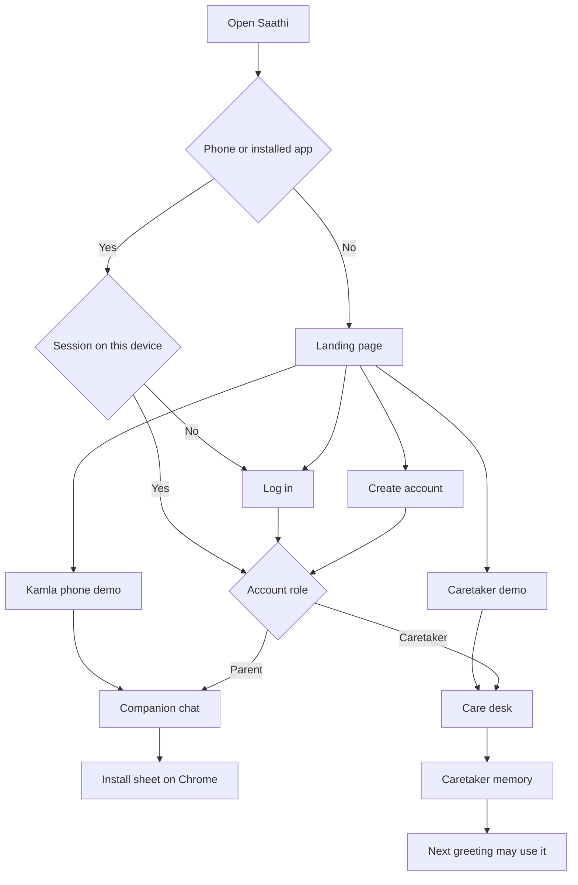
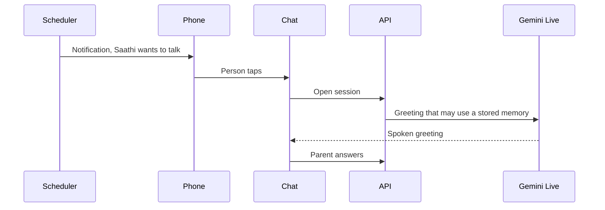
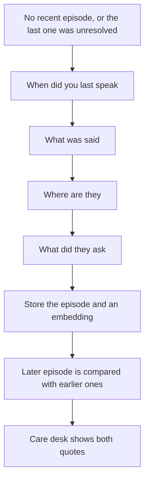
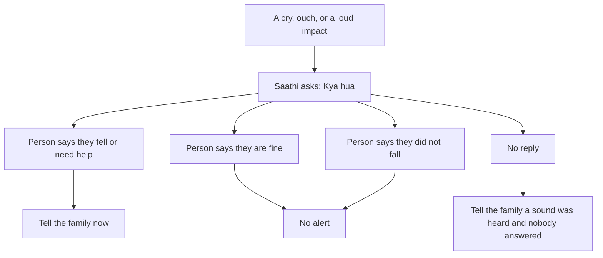

# What Saathi is

Saathi is a proactive Hindi companion for an older adult whose family lives somewhere else. The parent should not fill a form to start the day. The caretaker should be able to see what changed, and to add the facts that make the next conversation specific to that person.

This file is the product behavior. [ARCHITECTURE.md](ARCHITECTURE.md) is the system. [MASTER_PLAN.md](MASTER_PLAN.md) is what ships on Sunday and what waits.

## The two fronts

One web app. The account role chooses the front. A caretaker opens the care desk at `/care`. A parent opens the companion chat at `/app`. They are separate Firebase accounts that share one household after the parent joins with a family code. On `/care`, a window at least 1024px wide uses a sidebar. Below that, the desk uses a top bar and bottom tabs. Width does not switch a parent into the desk.

### Landing page

A desktop page with a header and a footer.

1. The name, one sentence, and three short lines: Saathi speaks first, remembers the family, and tells the child when something changes.
2. Header links reach Log in, Create account, the Kamla Sharma demo, and the caretaker demo. The account forms are not on this page.
3. **Try the Kamla Sharma demo.** No account form. Kamla is 78 and lives in Varanasi. Rahul, her son in Bengaluru, is the caretaker. The household is synthetic and labeled.
4. The footer says the phone site can be installed, a closed app does not listen, and a speaker in the room is later work.

### Log in and create account

Separate pages. Each asks for email and password, and offers Google sign-in.

Create account first asks who the account is for: **I'm caring for someone** (caretaker) or **It's for me** (the older adult). The caretaker path asks for their name, the parent's preferred name, and the language. The parent path asks what Saathi should call them and the language. Both paths end with an agreement box about what Saathi keeps (words for 7 days, summaries for 30); the account is not created until it is ticked. The role is stored with the account, so Log in asks only for email and password.

Google sign-up already has a name and an email. It continues once at `/details`, which asks who Saathi will talk with, the language, and the city. The city is what nearby help uses until a phone shares a position. After that, the role's home opens.

### Family code

The care desk's Profile tab makes a family code, such as `KMR-4F7`, and a join link, `/join/KMR-4F7`. The code avoids 0, O, 1, I, and L so it can be read aloud. The link carries only the code, never names.

Joining is a step after a parent signs in, not part of Log in:

- After a parent signs up, or logs in without a family, **Join your family** appears once with the code field and **Skip for now**.
- Someone who opens a join link without an account signs up first (the parent option is preselected), then lands on the join step with the code filled in.
- The parent's chat always shows a **Family** button. Before joining it opens the join form. After joining it shows the family code, who looks after them, and when they joined, with **Change code** to enter a new code from their family. The chat's subtitle shows whose family they joined. The Kamla demo has the same button, labelled Demo, and saves nothing.

The desk shows "Waiting for … to join" until then, and "Joined" after. Connecting the phone is the first step of Finish setting up. A new code replaces the old one for that household. Family codes and account profiles are stored in Firestore through the API (`users/<uid>` and the household pairing routes). Join works across devices that use the same cloud project. The browser keeps a desk cache; it is not the source of truth.

One caretaker account can look after up to 10 family members. The first household is named by the caretaker's email. Each person added later gets a household id `hh-...`, a desk, and a family code of their own. The care desk header opens a switcher: who is connected, who has an open notice, and **Add a family member** (name and language). The list of households is written only by `POST /api/v1/me/households`. A profile save cannot attach a household the account does not own. The Kamla demo is one synthetic household and does not add members.

A phone browser, and the installed app, skip the landing page. With no session they open Log in. With a session, a parent opens the companion chat and a caretaker opens the care desk at `/care`. A parent account never sees the desk, and a caretaker account never lands on the parent's chat.

### Care desk

The caretaker app lives at `/care` and works on a phone and on a computer: a sidebar at 1024px and wider, a top bar and a bottom tab bar below that. The parent's phone at `/app` shows the chat and nothing else, so an older adult never lands on a settings screen. A signed-in caretaker who opens `/app` is taken to `/care` at any width. A signed-in parent who opens `/care` is taken to `/app`. A link with `?demo=1` still opens that demo. The landing page offers two demos with no account form: Kamla's phone (`/app?demo=1`, shown in a phone frame on a computer) and the caretaker app (`/care?demo=1`).

The desk is five tabs, one section at a time, in this order. On a phone they sit in a curved bottom bar; the active tab's icon rises into a floating circle.

| Tab | What the caretaker does |
| --- | --- |
| Profile | Preferred name, language (Hindi, English, Bengali, Marathi, Gujarati, Punjabi, Tamil, Telugu, Kannada, Malayalam), city, persona, check-in time, quiet hours. People who matter (demo row: Rahul, son, Bengaluru). Memories you have added, each row showing who wrote it and when. Photos and documents, one form per category: profile photo, family photos, prescriptions, medical reports, medical bills, medicine strips, identity proofs, insurance, and other. Prescriptions, reports, bills, medicine strips, identity proofs, and insurance stay private. Profile photo, family photos, and other may be shared only when the caretaker opts in. A prescription or medical report image or PDF can be read once by Gemini Flash. The family lines copy what is printed and do not add a dose. The read opens in a popup. Habits on the page become suggested reminders the caretaker ticks; a visit such as a filling is one reminder, not a daily one. Nothing is saved until the caretaker confirms |
| Routine | At the very top, any urgent reminder: due within the next hour, or due in the last three hours and not yet confirmed. It says "Not yet confirmed", never "missed dose", and links to Reminders. Then meals mentioned, minutes talking, mood only when stated, family contact. Highlights, the family-episode card, and memories from conversations. A table view of the same days |
| Ask Saathi | Type or speak a change in plain words. Saathi reads it back and saves it only after the caretaker confirms. A question about how the parent has been is answered from stored summaries, daily numbers, reminder confirmations, and alerts for a window of 1 to 14 days (3 when the question does not say). The answer passes SafetyGuard. If the model is unreachable or the check fails, the same facts are returned as a plain list. It never suggests a dose and it never fills a day that has no record |
| Reminders | A kind (medicine, a walk or other exercise, a call, a meal or water, or other), a name, a dose only when someone typed one, once or daily, a time, and a date when it is once. The lock-screen line is the family's own sentence and never includes a dose. **Seen** means a phone accepted the push. **Confirmed** means the parent said they will do it. A desk save from an open browser does not wipe a status the phone just recorded |
| Trusted Contacts | Local emergency services first (112 in India), trusted contacts and who lives nearby, Elderline 14567, and a card of what is near the parent |

There is no single health score and the screen does not say the parent is safe. Deleting a person, a memory, a reminder, or a contact shows "Deleted · Undo" for a few seconds.

A caretaker memory stores the caretaker's name in `author` (or "You" when the name is missing). A correction from a conversation stores `author` `conversation`. Removing a memory takes it out of the next prompt. If the two disagree, both remain. The prompt lists caretaker memories first and conversation corrections after them.

### Companion chat

Talk, Stop, Pause, Contact family, and Nearby help. Captions are optional. Nearby help opens a sheet for a hospital, a medical shop, a grocery store, a park, food, a trusted person, or a helpline. A list the parent opens is saved for the care desk. Each row can show a Call button and, for a place, a directions link. The parent taps. Saathi does not place the call.

A signed-in parent sees **Allow location once** until they allow it or dismiss it. The point is rounded to about 100 metres and stored for that household. The shared demo never stores a position. Without one, nearby places use the city on the care desk. The family deletes the point from the Trusted Contacts card.

The chat Demo panel has four controls: Simulate morning inactivity (labeled "Simulated. This build does not read a Nest sensor."; it starts the same invitation the scheduler sends), a labeled distress clip, an ordinary door clip, and a seeded session. A demo visitor gets three voice sessions a day, counted when Talk starts; the seeded session still works after that. `DEMO_SESSIONS_PER_VISITOR=0` turns that cap off. The care desk Routine tab seeds labeled histories, runs a seeded session, and simulates an unanswered invitation versus a device that is unavailable. Advancing the logical clock is `POST /api/v1/demo/advance`, not a chat button.

## A day with Saathi

If the chat is already open and the screen is on, the greeting plays without a new tap. If the app is closed, the notification is the tap. The service worker shows it. When the app is already open, the same push speaks the line out loud. A tap opens the chat, and then the phone speaks. A closed app does not hold the microphone and does not run a wake word.

The parent turns notifications on from the chat. The caretaker turns them on from Routine. Each device registers its own Firebase Cloud Messaging token. Check-in text is "Saathi wants to talk". A reminder push speaks the line the family wrote and never a dose. A notice for the caretaker says "New Saathi update".

The first visit still needs one tap so the browser will allow the microphone and playback. The Live socket opens when the chat page opens, before that tap, so Talk does not wait for a new connection. Audio leaves the microphone as 16 kHz PCM and Saathi's voice returns as 24 kHz PCM, played one chunk after another with no gap. The browser asks the audio system for interactive latency.

## What the conversation does

Saathi uses two personas in this build.

| Persona | How it talks |
| --- | --- |
| Saathi | Warm, about meals, walks, hobbies, family, and social contact |
| Rakshak | Shorter, about meals, hydration, discomfort, and reminders the family already entered |

Sutra, a lifestyle mode, stays a named config and is not a third build.

The profile stores the English language name. Gemini Live takes the spoken language from the system instruction, so Hindi, English, Bengali, Marathi, Gujarati, Punjabi, Tamil, Telugu, Kannada, and Malayalam each have a prompt line. The server's own lines (the check after a loud sound, and the reply when the model is unreachable) and the yes, no, help, and fine word lists are in `api/src/saathi/languages.py`. The Kamla demo speaks Hindi. If the parent switches to Hindi or English, the prompt says to follow them.

Before the first word, the server writes the household into the system instruction: the name, the language, the city, the persona, the people who matter, the memories (caretaker facts first, conversation corrections after them), every reminder with its kind and time, the last three conversation summaries, topics the parent has declined, whether a position is shared, and the trusted people who live nearby. One family thread is included only when a named person has gone quiet. The packet stays inside 6,000 characters; if it is longer, the oldest summaries go first. Late at night the memories and the family thread are left out on purpose.

The model asks one question at a time. Some turns only acknowledge a story. It does not invent a shared past. It does not claim to be a family member. It follows the parent's topic. "Not now" ends the thread. If the parent starts speaking while Saathi is still talking, playback stops and the new turn is heard.

From 9 pm to 5 am the opening is a short hello and a rest wish. Memories, earlier summaries, family threads, walks, exercise, and outings stay out of that prompt. A park lookup is refused. Food, if asked for, is a phone call to a restaurant rather than going out.

### Family questions

Saathi does not read private chats. When a named person has gone quiet, it asks like a friend, one question at a time.

The Hindi shape of those questions is "Rahul se kab baat hui thi?", "Kya baat hui?", "Kahan hain woh?", "Unhone kya pucha?"

A guess stays uncertain. A negation ("kal baat nahi hui") is a real episode. Talk about a neighbour is not stored as Rahul. If the parent changes the subject, the thread stops.

The shift rule, not the model, decides that the story got worse:

- The reported gap is longer than this person's own earlier episodes, on two dates.
- Or an earlier episode says they talk, and a later one says the parent does not know where the person is.
- Words the parent actually said, such as "akela lagta hai", are attached as quotes. Tone is not inferred.

The care desk then says, in substance, that the mentions changed across these quotes, and that a call or a counsellor the family chooses is a reasonable next step. It links Elderline 14567 and says to confirm the parent's state. It does not name a disorder and it does not order counselling.

### Reminders

The parent can create a reminder by voice. The caretaker can create the same reminder on the desk. Missing time is a question, not a guess. Saathi reads the reminder back and saves it only after the person confirms.

Medicine text is copied from what a person typed. "I don't remember if I took it" is stored as uncertain. Saathi never suggests another dose.

A reminder can also be a walk, a call, a meal or water, or something else. When one is already due, Saathi says the family's line once and asks whether the parent is going to do it. The parent's own words confirm it. "Haan", "kar lunga", "ja raha hoon", "ho gaya", "done", and the same idea in the other supported languages mark that reminder confirmed for today, under the parent's name. If they name the reminder, that one is confirmed. If they do not, the latest one still open today is confirmed. "Nahi", "baad mein", "not now", and "yaad nahi" do not confirm. A bare "ji" does not. Hearing the notification, or the caretaker tapping the desk, records "seen" for today and leaves confirmed empty. The lock screen never includes a dose.

### Distress during an open call

The microphone is open for the invitation and the conversation, then released.

The alert does not say a fall was confirmed unless the person said so. A door clip in the demo must not alert. Pill identification, gas, and breaking glass are not in this build.

### Help nearby

The phone and the care desk name the next festival on the calendar. If the parent has already looked up a park, a place to eat, or a grocery store, that place is one invitation, and only before 9 pm. If the parent asks during a talk, Saathi looks up the holiday calendar and, only for a place, the Places list. A list from the last day is reused. A festival question does not search for places. A specific place that is not in the fixed list, such as a temple, is one text search, and the names returned are the only names Saathi may say. When the parent asks for a hospital, a medical shop, a grocery store, a park, somewhere to eat, a helpline, or a trusted person, the Live tool `find_nearby` looks it up. A card appears on the phone. That list is stored for the household, and the care desk shows the same places. `offer_call` shows a Call button for a number the server resolved from helplines, trusted contacts, or the places just found. The model does not invent a phone number and does not dial.

In danger, Saathi says to call 112 first and offers that call. A hospital is a place and a number, not advice about what is wrong. Ordering food is helping them call a restaurant. If the position was not shared, Saathi says it is looking in the city's results and that the Allow location button is on the screen. Helplines still work when the Places API is off: 112, 108, and Elderline 14567. The care desk shows the same card under Trusted Contacts, and the family can delete the saved position.

## After the call

Gemini Flash writes observations with quotes. Unknown stays unknown. Negation stays negation. A statement about someone else does not become a personal fact.

The browser measures the gap from the parent's last loud microphone frame to the first reply audio, and sends the median as `response_gap_ms`. Gemini Live does not provide that number. Speaking pace is the parent's words over the time those frames were loud, sent as `speaking_rate_wpm` when the call has at least three seconds of speech and three words. The care desk draws both on the same days, each against this person's earlier days, and writes the two averages in one sentence. Ask Saathi includes the same pause and pace when it answers how the parent has been. The Story demo loads the slower recent days and the two family quotes together. A session flagged `noisy`, `short`, `no_turns_measured`, or `mic_blocked`, or shorter than 20 seconds, is not treated as a confident pause. A missing duration is still accepted when none of those flags is set.

BigQuery compares this person with their own earlier days. Recent days are D-2 through D. The baseline is D-13 through D-3. At least 7 baseline days are required. A follow-up for response gap needs z at least 2 in the slower direction on two successive dates, and a baseline spread of at least 0.25 seconds. Meals, mood, and social contact are counts and dates, not one blended score. A named fast does not become a nutrition alert. Until the baseline is long enough, the desk says **Learning usual routine.**

## What the family is told

| Tier | When | What they see |
| --- | --- | --- |
| Level 1 | An isolated change | A quiet line on the desk |
| Level 2 | The drift rule, the family-episode shift, or two real unanswered invitations | One notice and a human next step |
| Level 3 | A present-tense request for help, Contact family, or the distress rule | An immediate notice. The copy says to contact local emergency services. After a drift flag or a level-3 notice, the desk shows a Tonight card: 112, Elderline 14567, and the trusted contact who lives nearby. The parent taps Call. Nothing dials by itself |

"I did not fall" is not Level 3. A blocked microphone is "device unavailable", not "she ignored the check-in."

Every sentence the family sees passes SafetyGuard. If the draft names a diagnosis, advises a dose, or orders counselling, it is replaced by a sentence built from the stored facts.

## Check-in copy

| Kind | Lock screen |
| --- | --- |
| Time to talk | Saathi wants to talk |
| Something for the caretaker | New Saathi update |

The notification does not contain a name, a quote, or a medicine.

## Published research, separate from this prototype

These sentences may appear on a slide. Each one is someone else's result.

| Claim | Source |
| --- | --- |
| In a 2015 meta-analysis, loneliness, social isolation, and living alone were associated with a higher chance of earlier death. The authors do not claim a cause. | Holt-Lunstad, Smith, Baker, Harris, and Stephenson, Perspectives on Psychological Science, 2015. https://doi.org/10.1177/1745691614568352 |
| About 1 in 6 people worldwide felt lonely across 2014 to 2023. | WHO Commission on Social Connection, 30 June 2025. https://www.who.int/groups/commission-on-social-connection/report |
| In India's LASI Wave 1, about 6 percent of people aged 60 and above were living alone, and about 9 percent of women in that age group were. Living alone is not a loneliness score. | LASI Wave 1 executive summary, 2020. https://www.iipsindia.ac.in/sites/default/files/LASI_India_Executive_Summary.pdf |

Bruce K. Alexander's Rat Park work is about morphine intake in rats. It is not evidence about older adults, and it does not go on the impact slide.

The deck does not say Saathi reduced deaths, hospital days, or insurance claims.
