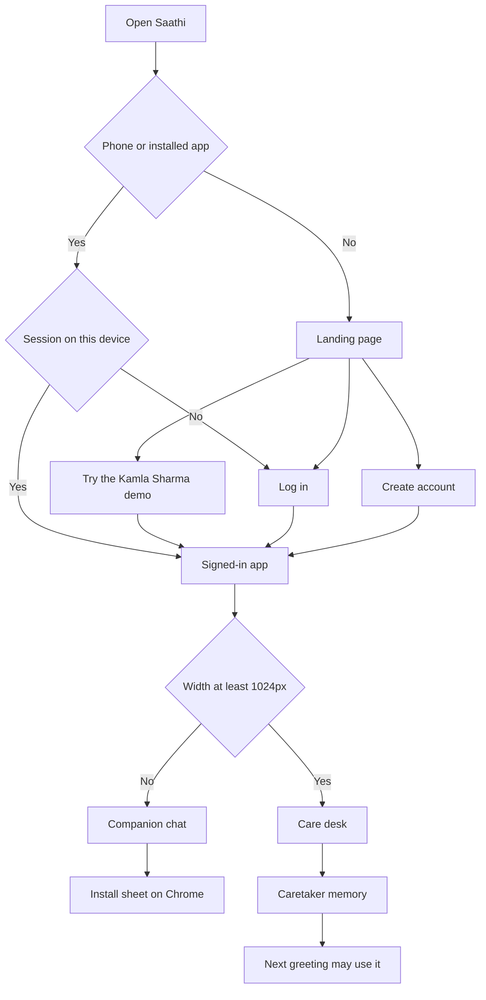
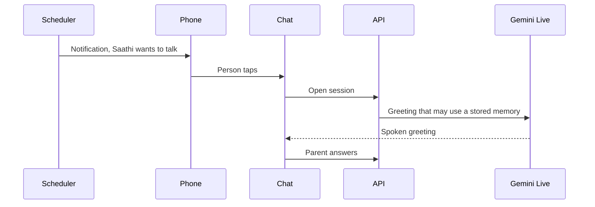
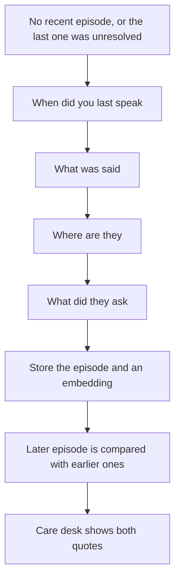
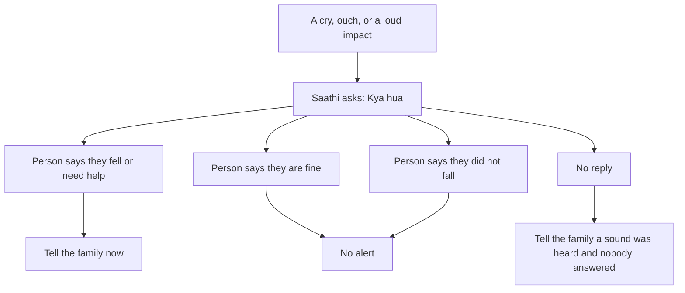

# What Saathi is

Saathi is a proactive Hindi companion for an older adult whose family lives somewhere else. The parent should not fill a form to start the day. The caretaker should be able to see what changed, and to add the facts that make the next conversation specific to that person.

This file is the product behavior. [ARCHITECTURE.md](ARCHITECTURE.md) is the system. [MASTER_PLAN.md](MASTER_PLAN.md) is what ships on Sunday and what waits.

## The two fronts

One web app. The width of the window chooses the front. Both fronts share one Firebase user and one household.

### Landing page

A desktop page with a header and a footer.

1. The name, one sentence, and three short lines: Saathi speaks first, remembers the family, and tells the child when something changes.
2. Header links reach Log in, Create account, and the Kamla Sharma demo. The account forms are not on this page.
3. **Try the Kamla Sharma demo.** No account form. Kamla is 78 and lives in Varanasi. Rahul, her son in Bengaluru, is the caretaker. The household is synthetic and labeled.
4. The footer says the phone site can be installed, a closed app does not listen, and a speaker in the room is later work.

### Log in and create account

Separate pages. Each asks for email and password, and offers Google sign-in. Signup also asks for the caretaker's name, the parent's preferred name, and the language.

A phone browser, and the installed app, skip the landing page. With no session they open Log in. With a session they open the companion chat. A wide window still shows the care desk once the app is open.

### Care desk

Shown at 1024px and wider. A phone has a text button, **Care desk**, that stacks the same sections. The default phone screen stays the chat.

| Card | What the caretaker does |
| --- | --- |
| This person | Preferred name, language, city, persona, check-in time, quiet hours |
| People who matter | Name, relation, city. Demo row: Rahul, son, Bengaluru |
| Memories you have added | Short facts. Each row shows who wrote it |
| Memories from conversations | Latest verified facts and the last three summaries |
| Major updates | Latest insight, family quotes, call, trusted contact |
| The last 14 days | Meals, response gap, social contact, reported mood |
| Reminders | Next due time and reported status |

There is no single health score and the screen does not say the parent is safe.

A caretaker fact is stored with source `caregiver`. A conversation fact is stored with source `conversation`. Deleting a caretaker fact removes it from the next prompt. If the two disagree, both remain, and the later correction is the one the prompt prefers.

### Companion chat

Talk, Stop, Pause, and Contact family. Captions are optional. Demo controls sit in a panel marked Demo: simulated inactivity, demo clock, seeded session, distress clip, ordinary door clip.

## A day with Saathi

If the chat is already open and the screen is on, the greeting plays without a new tap. If the app is closed, the notification is the tap. A closed app does not hold the microphone and does not run a wake word.

The first visit still needs one tap so the browser will allow the microphone and playback.

## What the conversation does

Saathi uses two personas in this build.

| Persona | How it talks |
| --- | --- |
| Saathi | Warm, about meals, walks, hobbies, family, and social contact |
| Rakshak | Shorter, about meals, hydration, discomfort, and reminders the family already entered |

Sutra, a lifestyle mode, stays a named config and is not a third build.

The model asks one question at a time. Some turns only acknowledge a story. It does not invent a shared past. It does not claim to be a family member. It follows the parent's topic. "Not now" ends the thread.

### Family questions

Saathi does not read private chats. When a named person has gone quiet, it asks like a friend, one question at a time.

The Hindi shape of those questions is "Rahul se kab baat hui thi?", "Kya baat hui?", "Kahan hain woh?", "Unhone kya pucha?"

A guess stays uncertain. A negation ("kal baat nahi hui") is a real episode. Talk about a neighbour is not stored as Rahul. If the parent changes the subject, the thread stops.

The shift rule, not the model, decides that the story got worse:

- The reported gap is longer than this person's own earlier episodes, on two dates.
- Or an earlier episode says they talk, and a later one says the parent does not know where the person is.
- Words the parent actually said, such as "akela lagta hai", are attached as quotes. Tone is not inferred.

The care desk then says, in substance, that the mentions changed across these quotes, and that a call or a counsellor the family chooses is a reasonable next step. It links Elderline 14567 and says to confirm the parent's state. It does not name a disorder and it does not order counselling.

### Reminders

The parent can create a reminder by voice. The caretaker can create the same reminder on the desk. Missing time is a question, not a guess. Saathi reads the reminder back and saves it only after the person confirms.

Medicine text is copied from what a person typed. "I don't remember if I took it" is stored as uncertain. Saathi never suggests another dose.

### Distress during an open call

The microphone is open for the invitation and the conversation, then released.

The alert does not say a fall was confirmed unless the person said so. A door clip in the demo must not alert. Pill identification, gas, and breaking glass are not in this build.

## After the call

Gemini Flash writes observations with quotes. Unknown stays unknown. Negation stays negation. A statement about someone else does not become a personal fact.

The browser measures the pause from the end of playback to the start of the parent's speech, and an estimate of speaking rate. Gemini Live does not provide that number. Noisy or very short sessions are flagged and are not treated as a confident pause.

BigQuery compares this person with their own earlier days. Recent days are D-2 through D. The baseline is D-13 through D-3. At least 7 baseline days are required. A follow-up for response gap needs z at least 2 in the slower direction on two successive dates, and a baseline spread of at least 0.25 seconds. Meals, mood, and social contact are counts and dates, not one blended score. A named fast does not become a nutrition alert. Until the baseline is long enough, the desk says **Learning usual routine.**

## What the family is told

| Tier | When | What they see |
| --- | --- | --- |
| Level 1 | An isolated change | A quiet line on the desk |
| Level 2 | The drift rule, the family-episode shift, or two real unanswered invitations | One notice and a human next step |
| Level 3 | A present-tense request for help, Contact family, or the distress rule | An immediate notice. The copy says to contact local emergency services |

"I did not fall" is not Level 3. A blocked microphone is "device unavailable", not "she ignored the check-in."

Every sentence the family sees passes SafetyGuard. If the draft names a diagnosis, advises a dose, or orders counselling, it is replaced by a sentence built from the stored facts.

## Check-in copy

| Kind | Lock screen |
| --- | --- |
| Time to talk | Saathi wants to talk |
| Something for the caretaker | New Saathi update |

The notification does not contain a name, a quote, or a medicine.

## Published research, separate from this prototype

These sentences may appear on a slide. Each one is someone else's result.

| Claim | Source |
| --- | --- |
| In a 2015 meta-analysis, loneliness, social isolation, and living alone were associated with a higher chance of earlier death. The authors do not claim a cause. | Holt-Lunstad, Smith, Baker, Harris, and Stephenson, Perspectives on Psychological Science, 2015. https://doi.org/10.1177/1745691614568352 |
| About 1 in 6 people worldwide felt lonely across 2014 to 2023. | WHO Commission on Social Connection, 30 June 2025. https://www.who.int/groups/commission-on-social-connection/report |
| In India's LASI Wave 1, about 6 percent of people aged 60 and above were living alone, and about 9 percent of women in that age group were. Living alone is not a loneliness score. | LASI Wave 1 executive summary, 2020. https://www.iipsindia.ac.in/sites/default/files/LASI_India_Executive_Summary.pdf |

Bruce K. Alexander's Rat Park work is about morphine intake in rats. It is not evidence about older adults, and it does not go on the impact slide.

The deck does not say Saathi reduced deaths, hospital days, or insurance claims.
